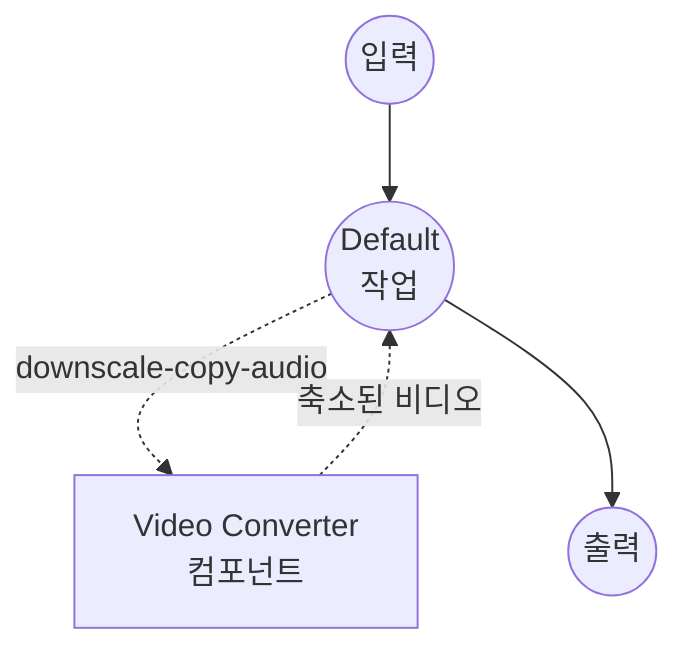

# Video Downscaler 예제

이 예제는 `video-converter` 컴포넌트와 ffmpeg를 사용하여 비디오 해상도를 축소(예: 1080p → 720p)하는 방법을 보여줍니다. 기본적으로 오디오 트랙은 stream-copy되므로 비디오 스트림만 재인코딩되어 파이프라인이 빠르고 품질 손실도 한 곳에 국한됩니다.

## 개요

이 워크플로우는 새로운 세로 길이로 비디오 스트림만 재인코딩하고 오디오는 그대로 둡니다. 목표 `height`를 인코더에 전달하면 원본의 종횡비를 유지하도록 가로 길이가 자동 계산되므로, 어떤 비율의 입력이든 올바른 크기의 결과물이 나옵니다. 두 가지 워크플로우를 제공합니다:

1. **Downscale Video Resolution**(기본): `codec: copy`로 오디오 트랙을 그대로 복사. 가장 빠른 경로이며 오디오 품질 손실이 없음.
2. **Downscale and Re-encode Audio**: 오디오를 AAC로 재인코딩(비트레이트 설정 가능). 원본 오디오 코덱이 대상 MP4 컨테이너와 호환되지 않거나 완전히 재인코딩된 출력을 원할 때 사용.

`quality` 입력은 ffmpeg의 Constant Rate Factor(CRF)로 전달됩니다:

- `0` — 무손실
- `18` — 거의 투명(시각적으로 원본과 동일)
- `23` — x264 기본값, 무난한 중간 지점
- `28`-`30` — 눈에 띄는 압축, 훨씬 작은 파일
- `51` — 최저 품질

같은 세로 길이에서 품질과 파일 크기를 조정하는 핵심 레버는 `quality`입니다.

## 준비사항

### 필수 요구사항

- model-compose가 설치되어 PATH에서 사용 가능
- [ffmpeg](https://ffmpeg.org/)가 설치되어 PATH에서 사용 가능

### 환경 구성

1. 이 예제 디렉토리로 이동:
   ```bash
   cd examples/media-processing/video-downscaler
   ```

2. ffmpeg 설치 확인:
   ```bash
   ffmpeg -version
   ```

## 실행 방법

1. **서비스 시작:**
   ```bash
   model-compose up
   ```

2. **워크플로우 실행:**

   **웹 UI 사용:**
   - Web UI 열기: http://localhost:8081
   - 워크플로우 탭 선택(기본은 **Downscale Video Resolution**)
   - 비디오 파일 업로드
   - 목표 세로 길이, CRF 품질, 비디오 코덱 선택
   - "Run Workflow" 버튼 클릭
   - 축소된 비디오 다운로드

   **API 사용:**
   ```bash
   curl -X POST http://localhost:8080/api/workflows/runs \
     -F "video=@input.mp4" \
     -F "height=720" \
     -F "quality=23" \
     -F "codec=libx264"
   ```

   **CLI 사용:**
   ```bash
   # 기본 워크플로우 (오디오 stream-copy)
   model-compose run --input '{
     "video": "./input.mp4",
     "height": 720,
     "quality": 23
   }'

   # 오디오 재인코딩 변형
   model-compose run downscale-reencode-audio --input '{
     "video": "./input.mp4",
     "height": 720,
     "quality": 23,
     "audio_bitrate": "128k"
   }'
   ```

## 워크플로우 세부사항

### "Downscale Video Resolution" 워크플로우 (기본)

목표 세로 길이로 비디오 스트림을 재인코딩하고(가로 길이는 종횡비 유지), 오디오는 stream-copy합니다.

#### 작업 흐름



#### 입력 매개변수

| 매개변수 | 유형 | 필수 | 옵션 | 기본값 | 설명 |
|---------|------|------|------|--------|------|
| `video` | video | 예 | - | - | 축소할 원본 비디오 |
| `height` | select | 아니오 | `1080`, `720`, `480`, `360`, `240` | `720` | 출력 세로 길이(픽셀); 가로 길이는 원본 종횡비를 유지하도록 자동 계산됨 |
| `quality` | integer | 아니오 | 0-51 | `23` | x264/x265 CRF; 낮을수록 고품질 |
| `codec` | select | 아니오 | `libx264`, `libx265` | `libx264` | 비디오 코덱; `libx265`는 동일 품질 기준 비트레이트가 대략 절반이지만 느림 |

#### 출력

| 필드 | 유형 | 설명 |
|-----|------|------|
| `video` | video | 축소된 비디오 파일 |

### "Downscale and Re-encode Audio" 워크플로우

기본 워크플로우와 동일하지만 오디오 트랙도 AAC로 재인코딩합니다. 입력 매개변수가 하나 추가됩니다:

| 매개변수 | 유형 | 필수 | 옵션 | 기본값 | 설명 |
|---------|------|------|------|--------|------|
| `audio_bitrate` | select | 아니오 | `64k`, `96k`, `128k`, `192k` | `128k` | AAC 오디오 비트레이트 |

## 설정 선택 가이드

### 세로 길이 고르기

실제 최종 뷰어에게 필요한 가장 작은 세로 길이를 선택하세요 — 다운스케일링은 비용이 적고, 재생 시 업스케일링은 공짜이며, 비트레이트는 대략 픽셀 수에 비례합니다.

| 사용 목적 | 추천 세로 길이 |
|-----------|---------------|
| 모바일 프리뷰, 채팅 클립 | `360` 또는 `480` |
| 일반 웹 재생 | `720` |
| 고품질 웹 재생 | `1080` |

### 품질(CRF) 고르기

`23`에서 시작하고, 결과물에 문제가 있거나 여전히 너무 클 때만 조정하세요:

- 결과물이 괜찮은데 파일이 너무 큼 → `26`-`28`로 올리기
- 블로킹/밴딩이 눈에 보임 → `20`-`21`로 내리기
- 아카이빙 / "시각적으로 동일한" 품질 → `18`

### `libx264` vs `libx265`

`libx265`(HEVC)는 같은 CRF에서 `libx264`보다 파일 크기가 약 25-50% 작지만 인코딩이 훨씬 오래 걸리고, 일부 재생 환경(구형 Android, 일부 브라우저)에서는 네이티브 지원이 안 됩니다. HEVC가 꼭 필요한 경우가 아니면 `libx264`를 쓰세요.

## 문제 해결

1. **ffmpeg를 찾을 수 없음**: `ffmpeg -version`으로 ffmpeg가 PATH에 있는지 확인하세요.
2. **오디오 stream-copy 실패**: 원본 오디오 코덱이 MP4 컨테이너와 호환되지 않는 경우(예: `.mov` 캡처의 일부 PCM 변형), `downscale-reencode-audio` 워크플로우로 전환하세요.
3. **출력 파일이 여전히 너무 큼**: 먼저 `quality`를 올리고(예: `23` → `28`), 그 다음 `height`를 한 단계 낮추세요. CRF를 조정하기 전에 세로 길이를 낮추면 같은 파일 크기에서 더 선명한 결과를 얻는 경우가 많습니다.
4. **출력이 예상보다 흐릿함**: `quality`를 `18`쪽으로 내리거나 `height`를 한 단계 올리세요.
