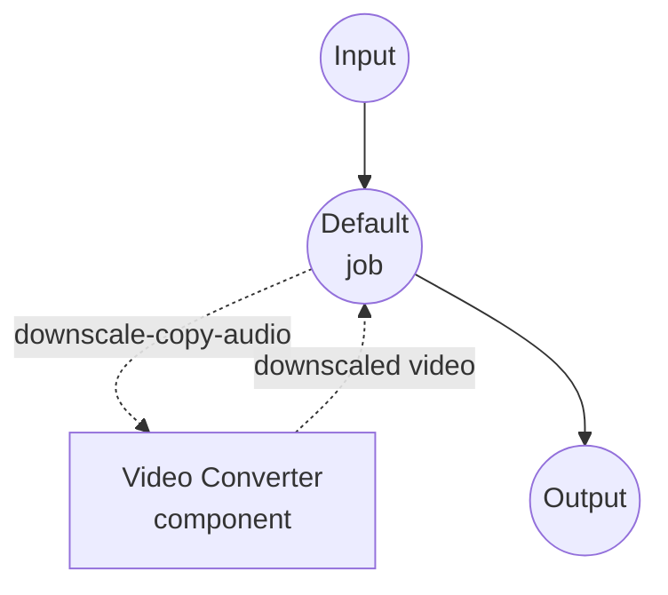

# Video Downscaler Example

This example demonstrates how to reduce a video's resolution (e.g. 1080p → 720p) using the `video-converter` component with ffmpeg. The audio track is stream-copied by default so only the video stream is re-encoded, keeping the pipeline fast and quality loss confined to one place.

## Overview

The workflow re-encodes just the video stream at a new height while leaving the audio untouched. The target `height` is passed to the encoder and the width is derived automatically to preserve the source's aspect ratio, so an input of any shape resolves to a correctly-sized output. Two workflows are provided:

1. **Downscale Video Resolution** (default): copies the audio track verbatim with `codec: copy`. Fastest path, no audio quality loss.
2. **Downscale and Re-encode Audio**: re-encodes audio to AAC at a configurable bitrate. Use this when the source audio codec is not compatible with the target MP4 container, or when you want a fully re-encoded output.

The `quality` input is passed to ffmpeg as a Constant Rate Factor (CRF):

- `0` — lossless
- `18` — near-transparent (visually identical to the source)
- `23` — x264 default, a sensible middle ground
- `28`-`30` — noticeably compressed, much smaller files
- `51` — worst quality

Raising `quality` is the primary knob for trading quality for file size at a fixed resolution.

## Preparation

### Prerequisites

- model-compose installed and available in your PATH
- [ffmpeg](https://ffmpeg.org/) installed and available in your PATH

### Environment Configuration

1. Navigate to this example directory:
   ```bash
   cd examples/media-processing/video-downscaler
   ```

2. Verify ffmpeg is installed:
   ```bash
   ffmpeg -version
   ```

## How to Run

1. **Start the service:**
   ```bash
   model-compose up
   ```

2. **Run the workflow:**

   **Using Web UI:**
   - Open the Web UI: http://localhost:8081
   - Pick the workflow tab (default is **Downscale Video Resolution**)
   - Upload a video file
   - Choose a target height, CRF quality, and video codec
   - Click the "Run Workflow" button
   - Download the downscaled video

   **Using API:**
   ```bash
   curl -X POST http://localhost:8080/api/workflows/runs \
     -F "video=@input.mp4" \
     -F "height=720" \
     -F "quality=23" \
     -F "codec=libx264"
   ```

   **Using CLI:**
   ```bash
   # Default workflow (audio stream-copied)
   model-compose run --input '{
     "video": "./input.mp4",
     "height": 720,
     "quality": 23
   }'

   # Re-encode audio variant
   model-compose run downscale-reencode-audio --input '{
     "video": "./input.mp4",
     "height": 720,
     "quality": 23,
     "audio_bitrate": "128k"
   }'
   ```

## Workflow Details

### "Downscale Video Resolution" Workflow (Default)

Re-encodes the video stream at the target height (width derived to preserve aspect ratio) and stream-copies the audio.

#### Job Flow



#### Input Parameters

| Parameter | Type | Required | Options | Default | Description |
|-----------|------|----------|---------|---------|-------------|
| `video` | video | Yes | - | - | Source video to downscale |
| `height` | select | No | `1080`, `720`, `480`, `360`, `240` | `720` | Target output height in pixels; width is derived automatically to preserve the source's aspect ratio |
| `quality` | integer | No | 0-51 | `23` | x264/x265 CRF; lower is higher quality |
| `codec` | select | No | `libx264`, `libx265` | `libx264` | Video codec; `libx265` is roughly half the bitrate at the same quality but slower |

#### Output

| Field | Type | Description |
|-------|------|-------------|
| `video` | video | The downscaled video file |

### "Downscale and Re-encode Audio" Workflow

Same as the default workflow, but also re-encodes the audio track to AAC. Adds one extra input:

| Parameter | Type | Required | Options | Default | Description |
|-----------|------|----------|---------|---------|-------------|
| `audio_bitrate` | select | No | `64k`, `96k`, `128k`, `192k` | `128k` | AAC audio bitrate |

## Choosing Settings

### Picking a height

Pick the smallest height the final viewer actually needs — downscaling is cheap, upscaling at playback time is free, and bitrate scales roughly with pixel count.

| Target use | Suggested height |
|-----------|------------------|
| Mobile preview, chat clip | `360` or `480` |
| Standard web playback | `720` |
| High-quality web playback | `1080` |

### Picking a quality (CRF)

Start at `23` and only move if the output looks wrong or is still too big:

- Output looks fine but too big → raise to `26`-`28`.
- Output has visible blocking/banding → lower to `20`-`21`.
- Archival / "visually identical" → `18`.

### `libx264` vs `libx265`

`libx265` (HEVC) produces files roughly 25-50% smaller than `libx264` at the same CRF, but encoding takes significantly longer and some playback environments (older Android, some browsers) still don't support it natively. Stick with `libx264` unless you specifically need HEVC.

## Troubleshooting

1. **ffmpeg Not Found**: Make sure `ffmpeg` is on your PATH (`ffmpeg -version`).
2. **Audio stream-copy fails**: If the source audio codec is not compatible with the MP4 container (e.g. some PCM variants from `.mov` capture), switch to the `downscale-reencode-audio` workflow.
3. **Output file is still too large**: Raise `quality` first (e.g. `23` → `28`), then step `height` down one tier. Lowering the output height before tweaking CRF usually gives sharper-looking output for the same file size.
4. **Output looks softer than expected**: Lower `quality` toward `18`, or move `height` up one tier.
