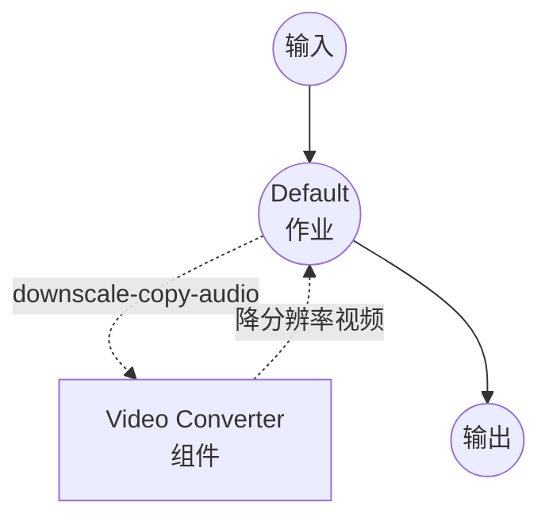

# Video Downscaler 示例

此示例演示如何使用 `video-converter` 组件和 ffmpeg 来降低视频的分辨率（例如 1080p → 720p）。默认情况下音频轨道采用 stream-copy，因此只有视频流会被重新编码，从而保持流水线的高速，并将质量损失限制在一个环节。

## 概述

此工作流只会以新的高度重新编码视频流，而不改动音频。目标 `height` 会传给编码器，宽度会自动按原始宽高比推导，因此任意比例的输入都能得到尺寸正确的输出。提供两种工作流：

1. **Downscale Video Resolution**（默认）：使用 `codec: copy` 原样复制音频轨道。最快路径，无音频质量损失。
2. **Downscale and Re-encode Audio**：以可配置的比特率将音频重新编码为 AAC。当源音频编解码器与目标 MP4 容器不兼容，或希望得到完全重新编码的输出时使用。

`quality` 输入会作为 Constant Rate Factor（CRF）传给 ffmpeg：

- `0` — 无损
- `18` — 近似透明（视觉上与源相同）
- `23` — x264 默认值，合理的中间值
- `28`-`30` — 明显压缩，文件小得多
- `51` — 最差质量

在固定高度下，`quality` 是在质量与文件大小之间权衡的主要旋钮。

## 准备工作

### 先决条件

- 已安装 model-compose 并可在 PATH 中访问
- 已安装 [ffmpeg](https://ffmpeg.org/) 并可在 PATH 中访问

### 环境配置

1. 进入此示例目录：
   ```bash
   cd examples/media-processing/video-downscaler
   ```

2. 确认已安装 ffmpeg：
   ```bash
   ffmpeg -version
   ```

## 运行方法

1. **启动服务：**
   ```bash
   model-compose up
   ```

2. **运行工作流：**

   **使用 Web UI：**
   - 打开 Web UI：http://localhost:8081
   - 选择工作流标签（默认为 **Downscale Video Resolution**）
   - 上传视频文件
   - 选择目标高度、CRF 质量和视频编解码器
   - 点击 "Run Workflow" 按钮
   - 下载降分辨率后的视频

   **使用 API：**
   ```bash
   curl -X POST http://localhost:8080/api/workflows/runs \
     -F "video=@input.mp4" \
     -F "height=720" \
     -F "quality=23" \
     -F "codec=libx264"
   ```

   **使用 CLI：**
   ```bash
   # 默认工作流（音频 stream-copy）
   model-compose run --input '{
     "video": "./input.mp4",
     "height": 720,
     "quality": 23
   }'

   # 重新编码音频的变体
   model-compose run downscale-reencode-audio --input '{
     "video": "./input.mp4",
     "height": 720,
     "quality": 23,
     "audio_bitrate": "128k"
   }'
   ```

## 工作流详情

### "Downscale Video Resolution" 工作流（默认）

以目标高度重新编码视频流（宽度按宽高比自动计算），并对音频做 stream-copy。

#### 作业流程



#### 输入参数

| 参数 | 类型 | 必填 | 选项 | 默认值 | 说明 |
|-----|------|------|------|--------|------|
| `video` | video | 是 | - | - | 要降分辨率的源视频 |
| `height` | select | 否 | `1080`、`720`、`480`、`360`、`240` | `720` | 输出高度（像素）；宽度会按原始宽高比自动计算 |
| `quality` | integer | 否 | 0-51 | `23` | x264/x265 CRF；越低质量越高 |
| `codec` | select | 否 | `libx264`、`libx265` | `libx264` | 视频编解码器；`libx265` 在同等质量下比特率约为一半，但更慢 |

#### 输出

| 字段 | 类型 | 说明 |
|-----|------|------|
| `video` | video | 降分辨率后的视频文件 |

### "Downscale and Re-encode Audio" 工作流

与默认工作流相同，但也会将音频轨道重新编码为 AAC。多了一个输入参数：

| 参数 | 类型 | 必填 | 选项 | 默认值 | 说明 |
|-----|------|------|------|--------|------|
| `audio_bitrate` | select | 否 | `64k`、`96k`、`128k`、`192k` | `128k` | AAC 音频比特率 |

## 配置选择

### 选择高度

选择最终观看者实际需要的最小高度 —— 降分辨率成本低，播放时放大是免费的，而比特率大致随像素数线性增长。

| 使用场景 | 建议高度 |
|---------|---------|
| 移动端预览、聊天剪辑 | `360` 或 `480` |
| 标准网页播放 | `720` |
| 高质量网页播放 | `1080` |

### 选择质量（CRF）

从 `23` 开始，仅在输出效果不佳或文件仍然过大时调整：

- 输出看起来不错但文件过大 → 提高到 `26`-`28`。
- 输出有明显的块状/色带 → 降低到 `20`-`21`。
- 归档 / "视觉上相同" → `18`。

### `libx264` vs `libx265`

`libx265`（HEVC）在相同 CRF 下文件比 `libx264` 小约 25-50%，但编码时间显著更长，且部分播放环境（旧 Android、部分浏览器）仍不原生支持。除非你特别需要 HEVC，否则请继续使用 `libx264`。

## 故障排除

1. **找不到 ffmpeg**：确保 `ffmpeg` 在 PATH 中（`ffmpeg -version`）。
2. **音频 stream-copy 失败**：如果源音频编解码器与 MP4 容器不兼容（例如来自 `.mov` 采集的某些 PCM 变体），请改用 `downscale-reencode-audio` 工作流。
3. **输出文件仍过大**：先提高 `quality`（例如 `23` → `28`），然后将 `height` 下调一个档位。在调整 CRF 之前先降低高度，通常能在相同文件大小下得到更清晰的输出。
4. **输出比预期柔和**：将 `quality` 向 `18` 下调，或将 `height` 上调一个档位。
