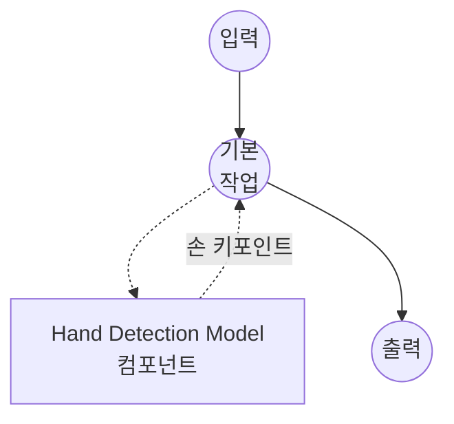

# Hand Detection Model Task 예제

이 예제는 model-compose의 내장 hand-detection 작업과 MediaPipe Hand Landmarker를 사용하여 이미지에서 손별 21개 랜드마크와 좌/우 손 구분을 검출하는 방법을 보여주며, 오프라인 손 분석 기능을 제공합니다.

## 개요

이 워크플로우는 다음과 같은 로컬 손 검출을 제공합니다:

1. **로컬 손 모델**: 외부 API 없이 Google의 MediaPipe Hand Landmarker 모델을 로컬에서 실행
2. **손당 21개 키포인트**: 손목 + 각 손가락(엄지/검지/중지/약지/새끼) 당 4개 관절
3. **좌/우 손 구분**: 각 검출된 손을 `"Left"` 또는 `"Right"`로 라벨링하며 신뢰도 점수 제공
4. **2D 및 3D 키포인트**: 픽셀 좌표와 선택적으로 실제 3D 공간 좌표(손목 중심, 미터 단위)
5. **바운딩 박스**: 21개 키포인트로부터 유도된 축 정렬 바운딩 박스
6. **선택적 스켈레톤 이미지**: 손별 스켈레톤 이미지 렌더링 가능 (natural HSV 레이아웃 또는 OpenPose 스타일 손가락별 색상, ControlNet Hand 입력으로 사용 적합)
7. **선택적 세그멘테이션 마스크**: inpaint/ControlNet 파이프라인용 convex-hull 기반 "손 영역" 마스크 생성 가능
8. **다중 손 검출**: 기본 두 손까지 검출; `max_detection_count`를 올리면 더 많이 검출 가능
9. **자동 모델 관리**: 첫 사용 시 모델을 자동으로 다운로드하고 캐시

## 준비사항

### 필수 요구사항

- model-compose가 설치되어 PATH에서 사용 가능
- MediaPipe 실행을 위한 충분한 시스템 리소스 (권장: 4GB+ RAM)
- `mediapipe`와 `Pillow`가 있는 Python 환경 (첫 실행 시 자동 설치)

### 로컬 손 검출을 사용하는 이유

클라우드 기반 비전 API와 달리 MediaPipe Hand Landmarker를 로컬에서 실행하면 다음을 제공합니다:

**로컬 처리의 이점:**
- **프라이버시**: 모든 이미지가 로컬에서 처리되며 외부 서비스로 데이터 전송 없음
- **비용**: 이미지당 또는 API 사용 요금 없음
- **오프라인**: 초기 모델 다운로드 후 인터넷 연결 없이 작동
- **지연시간**: 매 추론마다 네트워크 왕복이 없음
- **배치 처리**: 속도 제한 없이 무제한 이미지 처리

**트레이드오프:**
- **하드웨어 요구사항**: CPU 친화적이지만 실시간 비디오에는 여전히 적절한 리소스 필요
- **모델 제한**: Hand Landmarker는 심하게 가려진 손, 극단적인 각도, 프레임 내 매우 작은 손에 대해서는 성능이 저하됨

### 환경 구성

1. 이 예제 디렉토리로 이동:
   ```bash
   cd examples/model-tasks/hand-detection
   ```

2. 추가 환경 구성 불필요 — 모델과 의존성이 자동으로 관리됩니다.

## 실행 방법

1. **서비스 시작:**
   ```bash
   model-compose up
   ```

2. **워크플로우 실행:**

   **API 사용:**
   ```bash
   # 기본 손 검출 (양손, 보이는 경우)
   curl -X POST http://localhost:8080/api/workflows/runs \
     -F "image=@/path/to/your/image.jpg" \
     -F "input={\"image\": \"@image\"}"

   # 3D 키포인트 포함 (손목 중심, 미터 단위)
   curl -X POST http://localhost:8080/api/workflows/runs \
     -F "image=@/path/to/your/image.jpg" \
     -F "input={\"image\": \"@image\", \"return_keypoints_3d\": true}"

   # 두 손 이상 검출 (예: 단체 사진)
   curl -X POST http://localhost:8080/api/workflows/runs \
     -F "image=@/path/to/your/image.jpg" \
     -F "input={\"image\": \"@image\", \"max_detection_count\": 4}"

   # OpenPose 스타일 스켈레톤 이미지 렌더링 (ControlNet Hand 입력으로 사용 가능)
   curl -X POST http://localhost:8080/api/workflows/runs \
     -F "image=@/path/to/your/image.jpg" \
     -F "input={\"image\": \"@image\", \"return_skeleton_image\": true, \"skeleton_format\": \"openpose\"}"
   ```

   **Web UI 사용:**
   - Web UI 열기: http://localhost:8081
   - 이미지 파일 업로드
   - 선택적으로 `max_detection_count`, `min_confidence`, 3D 키포인트 / 크롭 마진 토글 조정
   - "Run Workflow" 버튼 클릭

   **CLI 사용:**
   ```bash
   # 기본 손 검출
   model-compose run hand-detection --input '{"image": "/path/to/your/image.jpg"}'

   # 3D 키포인트 포함
   model-compose run hand-detection --input '{"image": "/path/to/your/image.jpg", "return_keypoints_3d": true}'

   # 최대 네 손까지
   model-compose run hand-detection --input '{"image": "/path/to/your/image.jpg", "max_detection_count": 4}'
   ```

## 컴포넌트 상세

### Hand Detection Model Component (기본)
- **유형**: hand-detection 작업이 있는 Model 컴포넌트
- **목적**: 정지 이미지에서 손별 키포인트와 좌/우 손 구분 검출
- **드라이버**: `custom`
- **패밀리**: `blazehand`
- **모델**: `hand_landmarker.task` (첫 사용 시 Google MediaPipe 모델 저장소에서 다운로드)
- **기능**:
  - `~/.cache/mindor/models/mediapipe` 아래 자동 모델 다운로드 및 캐시
  - 검출된 손당 21개 손 랜드마크 출력 (손목 + 손가락별 4개 관절 × 5)
  - 손당 좌/우 손 라벨(`Left` / `Right`)과 신뢰도 점수
  - 실제 3D 좌표 (손목 중심, 미터 단위)
  - 보이는 키포인트로부터 유도된 축 정렬 바운딩 박스, `crop_margin_ratio`로 선택적 패딩

### 모델 정보: MediaPipe Hand Landmarker
- **개발자**: Google MediaPipe
- **유형**: 온디바이스 손 키포인트 검출
- **파이프라인**: 팜 디텍터 → 손 랜드마크 모델 (단일 `.task` 파일에 번들링)
- **랜드마크**: 손당 21개 키포인트
- **라이선스**: Apache 2.0

## 워크플로우 상세

### "Detect Hands from Image" 워크플로우 (기본)

**설명**: MediaPipe Hand Landmarker를 사용하여 입력 이미지에서 손별 21개 랜드마크와 좌/우 손 구분을 검출합니다.

#### 작업 흐름

이 예제는 명시적 작업 없이 간소화된 단일 컴포넌트 구성을 사용합니다.



#### 입력 매개변수

| 매개변수 | 유형 | 필수 | 기본값 | 설명 |
|---------|------|------|--------|------|
| `image` | image | 예 | - | 입력 이미지 파일 (JPEG, PNG 등) |
| `max_detection_count` | int | 아니오 | 2 | 이미지당 검출할 최대 손 수 |
| `min_confidence` | float | 아니오 | 0.5 | 팜 검출 최소 신뢰도 (0.0 - 1.0) |
| `min_presence_confidence` | float | 아니오 | 0.5 | 키포인트 존재 최소 신뢰도 (0.0 - 1.0) |
| `min_tracking_confidence` | float | 아니오 | 0.5 | 추적 최소 신뢰도 (향후 비디오 모드용 예약) |
| `return_keypoints_3d` | bool | 아니오 | false | 실제 3D 키포인트 포함 (손목 중심, 미터) |
| `return_segmentation_mask` | bool | 아니오 | false | 손별 그레이스케일 마스크 포함 (21개 키포인트 convex hull) |
| `return_skeleton_image` | bool | 아니오 | false | 손별 스켈레톤 이미지를 투명 캔버스 위에 렌더링 |
| `skeleton_format` | string | 아니오 | `natural` | 스켈레톤 레이아웃: `natural` (HSV 팔레트) 또는 `openpose` (손가락별 색상, ControlNet 호환) |
| `crop_margin_ratio` | float | 아니오 | 0.0 | 반환되는 바운딩 박스 주변에 추가되는 여백 (박스 자체 너비/높이 비율) |

#### 출력 형식

| 필드 | 유형 | 설명 |
|------|------|------|
| `result.hands` | array | 검출된 손. 각 항목은 항상 `handedness`, `handedness_score`, `bounding_box`와 (기본으로) `keypoints`를 포함하며, 요청 시 `keypoints_3d`, `segmentation_mask`, `skeleton_image`도 포함 |
| `result.width` | int | 분석된 이미지의 너비 (픽셀) |
| `result.height` | int | 분석된 이미지의 높이 (픽셀) |

각 손 항목:
- `handedness`: 모델 관점에서 `"Left"` 또는 `"Right"` (이미지 피사체 기준 미러링됨)
- `handedness_score`: 좌/우 분류 신뢰도 (0.0 - 1.0). 손당 유일한 신뢰도 값 — 키포인트별 `visibility`/`presence`는 제공되지 않습니다. Hand Landmarker는 가려진 경우에도 21개 포인트 모두 추론해 반환합니다.
- `bounding_box`: `{x, y, width, height}` 픽셀 좌표, 21개 키포인트로부터 유도 (`crop_margin_ratio`로 선택적 패딩)
- `keypoints`: 21개 항목, `x`, `y` (픽셀 좌표), `z` (손목 기준 상대 깊이; 값이 작을수록 카메라에 가까움)
- `keypoints_3d` *(선택)*: `keypoints`와 동일한 shape, 실제 미터 단위 (손목 중심)
- `segmentation_mask` *(선택)*: 21개 키포인트의 convex hull 안쪽을 채운 PNG 8비트 마스크 — 저비용 "손 영역" 대체물이며 **실제 실루엣은 아님**
- `skeleton_image` *(선택)*: PNG 손 스켈레톤 이미지 (레이아웃은 `skeleton_format`으로 결정)

## 시스템 요구사항

### 최소 요구사항
- **RAM**: 4GB (권장 8GB+)
- **디스크 공간**: hand landmarker 모델에 약 10MB
- **CPU**: 멀티코어 프로세서
- **인터넷**: 초기 모델 다운로드에만 필요

### 성능 참고사항
- 첫 실행 시 hand landmarker 다운로드 (~5MB)
- 모델 로딩에 몇 초 소요
- GPU 가속 불필요; CPU 추론만으로 정지 이미지에 충분히 빠름

## 커스터마이징

### 로컬에 다운로드한 모델 사용

```yaml
component:
  type: model
  task: hand-detection
  driver: custom
  family: blazehand
  model: ./models/hand_landmarker.task
```

### 한 번에 더 많은 손 검출

```yaml
component:
  action:
    image: ${input.image as image}
    max_detection_count: 6
    params:
      min_confidence: 0.4
```

### 3D 키포인트 활성화

`return_keypoints_3d: true`로 설정하면 손목 중심의 미터 단위 3D 좌표를 얻습니다. 손가락 관절을 3D 리깅된 캐릭터에 매핑하거나 카메라 거리와 무관하게 손가락 굽힘 각도를 계산할 때 유용합니다.

```yaml
component:
  action:
    image: ${input.image as image}
    return_keypoints_3d: true
```

### ControlNet용 스켈레톤 이미지 렌더링

`skeleton_format: openpose`로 설정하면 21점 손을 손가락별 색상 스킴(엄지=빨강, 검지=주황, 중지=노랑, 약지=초록, 새끼=파랑)으로 투명 캔버스 위에 렌더링합니다. `return_skeleton_image: true`와 함께 사용해 `hands[i].skeleton_image`를 ControlNet Hand 전처리기/모델에 바로 연결할 수 있습니다.

```yaml
component:
  action:
    image: ${input.image as image}
    return_keypoints: false
    return_skeleton_image: true
    skeleton_format: openpose
    output: ${result.hands[0].skeleton_image}
```

디버그용 시각화에는 기본값인 `skeleton_format: natural`을 유지하세요 — HSV 팔레트를 사용해 모든 관절/림이 시각적으로 구분됩니다.

### Inpaint 마스크 생성

21개 키포인트의 convex hull로 합성되는 마스크는 손목 + 손가락 끝을 감싼 볼록 다각형이므로 손가락 사이 틈은 하나의 영역으로 합쳐집니다. 정밀한 실루엣이 필요 없는 inpaint / ControlNet 파이프라인에서 "손 안쪽만 칠하기" 대략 마스크로 유용합니다.

```yaml
component:
  action:
    image: ${input.image as image}
    return_keypoints: false
    return_segmentation_mask: true
    output: ${result.hands[0].segmentation_mask}
```

### `pose-detection`과 함께 사용

Hand Landmarker는 `pose-detection`과 독립적으로 실행됩니다; MediaPipe는 pose의 손목 위치를 hand 검출 범위 제한에 재사용하지 않습니다. 한 워크플로우에서 몸 + 손가락을 모두 얻으려면, 두 컴포넌트를 같은 이미지에 대해 실행한 뒤 손의 손목 키포인트(index 0)와 pose의 손목 키포인트(BlazePose 기준 index 15 / 16이 좌/우)를 비교해 매칭합니다. 매칭되지 않은 손은 버릴 수 있고, 매칭된 손이 없는 pose는 손가락 랜드마크를 단순히 생략합니다.

## 문제 해결

### 일반적인 문제

1. **모델 다운로드 실패**: 인터넷 연결 확인 및 `storage.googleapis.com` 접근 가능 여부 확인
2. **`mediapipe` 임포트 오류**: Python 3.9+ 확인; `model-compose up`을 다시 실행하여 셋업 요구사항 설치
3. **손이 검출되지 않음**: `min_confidence`를 낮추거나, 손이 잘리지 않았는지 확인하거나, 고해상도 입력 시도
4. **좌/우가 뒤바뀜**: `handedness`는 모델 관점에서 보고되므로 이미지 속 인물 기준으로 미러링된 것임 — 버그가 아니라 설계상 동작

### 성능 최적화

- **이미지 전처리**: 매우 큰 이미지는 제출 전 다운스케일 — Hand Landmarker는 약 1024px 이상 해상도에서 이점이 없음
- **신뢰도 임계값**: `min_confidence`를 올리면 거짓 양성이 줄어들지만 부분적으로 보이는 손에 대한 재현율은 감소
