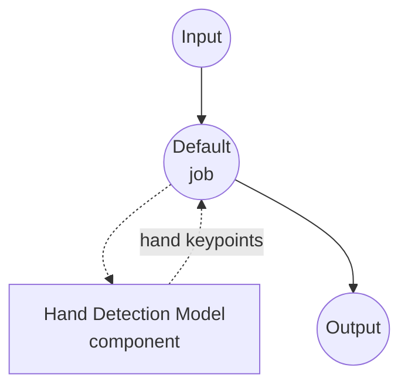

# Hand Detection Model Task Example

This example demonstrates how to use MediaPipe Hand Landmarker to detect per-hand 21-point landmarks and handedness from images using model-compose's built-in hand-detection task, providing offline hand analysis capabilities.

## Overview

This workflow provides local hand detection that:

1. **Local Hand Model**: Runs Google's MediaPipe Hand Landmarker locally without external APIs
2. **21 Keypoints per Hand**: Returns wrist + 4 joints per finger (thumb/index/middle/ring/pinky)
3. **Handedness**: Labels each detected hand as `"Left"` or `"Right"` with a confidence score
4. **2D & 3D Keypoints**: Pixel coordinates plus optional real-world 3D space (wrist-centered, meters)
5. **Bounding Box**: Axis-aligned bounding box derived from the 21 keypoints
6. **Optional Skeleton Image**: Can render a per-hand skeleton image (natural HSV layout or OpenPose-style per-finger colors, suitable as ControlNet Hand input)
7. **Optional Segmentation Mask**: Can emit a convex-hull "hand region" mask for inpaint/ControlNet pipelines
8. **Multi-Hand Detection**: Supports up to two hands by default; raise `max_detection_count` for more
9. **Automatic Model Management**: Downloads and caches the model automatically on first use

## Preparation

### Prerequisites

- model-compose installed and available in your PATH
- Sufficient system resources to run MediaPipe (recommended: 4GB+ RAM)
- Python environment with `mediapipe` and `Pillow` (installed automatically on first run)

### Why Local Hand Detection

Unlike cloud-based vision APIs, running MediaPipe Hand Landmarker locally provides:

**Benefits of Local Processing:**
- **Privacy**: All images are processed locally, no data sent to external services
- **Cost**: No per-image or API usage fees
- **Offline**: Works without an internet connection after the initial model download
- **Latency**: No network round-trip on every inference
- **Batch Processing**: Unlimited image processing without rate limits

**Trade-offs:**
- **Hardware Requirements**: CPU-friendly but still needs adequate resources for real-time video
- **Model Limitations**: Hand Landmarker struggles with heavily occluded hands, extreme angles, and very small hands in the frame

### Environment Configuration

1. Navigate to this example directory:
   ```bash
   cd examples/model-tasks/hand-detection
   ```

2. No additional environment configuration required — the model and dependencies are managed automatically.

## How to Run

1. **Start the service:**
   ```bash
   model-compose up
   ```

2. **Run the workflow:**

   **Using API:**
   ```bash
   # Basic hand detection (both hands, if visible)
   curl -X POST http://localhost:8080/api/workflows/runs \
     -F "image=@/path/to/your/image.jpg" \
     -F "input={\"image\": \"@image\"}"

   # Include 3D keypoints (wrist-centered, meters)
   curl -X POST http://localhost:8080/api/workflows/runs \
     -F "image=@/path/to/your/image.jpg" \
     -F "input={\"image\": \"@image\", \"return_keypoints_3d\": true}"

   # Detect more than two hands (e.g. group shot)
   curl -X POST http://localhost:8080/api/workflows/runs \
     -F "image=@/path/to/your/image.jpg" \
     -F "input={\"image\": \"@image\", \"max_detection_count\": 4}"

   # Render an OpenPose-style skeleton image (usable as ControlNet Hand input)
   curl -X POST http://localhost:8080/api/workflows/runs \
     -F "image=@/path/to/your/image.jpg" \
     -F "input={\"image\": \"@image\", \"return_skeleton_image\": true, \"skeleton_format\": \"openpose\"}"
   ```

   **Using Web UI:**
   - Open the Web UI: http://localhost:8081
   - Upload an image file
   - Optionally adjust `max_detection_count`, `min_confidence`, and toggles for 3D keypoints / crop margin
   - Click the "Run Workflow" button

   **Using CLI:**
   ```bash
   # Basic hand detection
   model-compose run hand-detection --input '{"image": "/path/to/your/image.jpg"}'

   # With 3D keypoints
   model-compose run hand-detection --input '{"image": "/path/to/your/image.jpg", "return_keypoints_3d": true}'

   # Up to four hands
   model-compose run hand-detection --input '{"image": "/path/to/your/image.jpg", "max_detection_count": 4}'
   ```

## Component Details

### Hand Detection Model Component (Default)
- **Type**: Model component with hand-detection task
- **Purpose**: Detect per-hand keypoints and handedness from still images
- **Driver**: `custom`
- **Family**: `blazehand`
- **Model**: `hand_landmarker.task` (downloaded from Google's MediaPipe model store on first use)
- **Features**:
  - Automatic model downloading and caching under `~/.cache/mindor/models/mediapipe`
  - 21-point hand landmark output per detected hand (wrist + 4 joints × 5 fingers)
  - Handedness label (`Left` / `Right`) with per-hand confidence score
  - Real-world 3D coordinates (wrist-centered, in meters)
  - Axis-aligned bounding box derived from visible keypoints, with optional `crop_margin_ratio` padding

### Model Information: MediaPipe Hand Landmarker
- **Developer**: Google MediaPipe
- **Type**: On-device hand keypoint detection
- **Pipeline**: Palm detector → hand-landmark model (bundled in a single `.task` file)
- **Landmarks**: 21 keypoints per hand
- **License**: Apache 2.0

## Workflow Details

### "Detect Hands from Image" Workflow (Default)

**Description**: Detect per-hand 21-point landmarks and handedness from an input image using MediaPipe Hand Landmarker.

#### Job Flow

This example uses a simplified single-component configuration without explicit jobs.



#### Input Parameters

| Parameter | Type | Required | Default | Description |
|-----------|------|----------|---------|-------------|
| `image` | image | Yes | - | Input image file (JPEG, PNG, etc.) |
| `max_detection_count` | int | No | 2 | Maximum number of hands to detect per image |
| `min_confidence` | float | No | 0.5 | Minimum palm-detection confidence (0.0 - 1.0) |
| `min_presence_confidence` | float | No | 0.5 | Minimum keypoint-presence confidence (0.0 - 1.0) |
| `min_tracking_confidence` | float | No | 0.5 | Minimum tracking confidence (reserved for future video mode) |
| `return_keypoints_3d` | bool | No | false | Include real-world 3D keypoints (wrist-centered, meters) |
| `return_segmentation_mask` | bool | No | false | Include a per-hand grayscale mask (convex hull of the 21 keypoints) |
| `return_skeleton_image` | bool | No | false | Render a per-hand skeleton image on a transparent canvas |
| `skeleton_format` | string | No | `natural` | Skeleton layout: `natural` (HSV palette) or `openpose` (per-finger color scheme, ControlNet-ready) |
| `crop_margin_ratio` | float | No | 0.0 | Margin added around each returned bounding box (ratio of its own width/height) |

#### Output Format

| Field | Type | Description |
|-------|------|-------------|
| `result.hands` | array | Detected hands. Each entry always includes `handedness`, `handedness_score`, `bounding_box`, and (by default) `keypoints`; may also include `keypoints_3d`, `segmentation_mask`, `skeleton_image` when requested |
| `result.width` | int | Width of the analyzed image in pixels |
| `result.height` | int | Height of the analyzed image in pixels |

Each hand entry:
- `handedness`: `"Left"` or `"Right"` from the model's perspective (mirrored relative to the image subject)
- `handedness_score`: Confidence of the handedness classification (0.0 - 1.0). This is the model's only per-hand confidence — there is no per-keypoint `visibility`/`presence`; the Hand Landmarker regresses all 21 points even when occluded.
- `bounding_box`: `{x, y, width, height}` in pixel coordinates, derived from the 21 keypoints (optionally padded by `crop_margin_ratio`)
- `keypoints`: 21 entries with `x`, `y` (pixel coordinates) and `z` (depth relative to the wrist; smaller = closer to camera)
- `keypoints_3d` *(optional)*: same shape as `keypoints`, in real-world meters (wrist-centered)
- `segmentation_mask` *(optional)*: PNG-encoded 8-bit mask filled inside the 21-keypoint convex hull — a cheap "hand region" stand-in, **not** a true silhouette
- `skeleton_image` *(optional)*: PNG-encoded hand skeleton (layout determined by `skeleton_format`)

## System Requirements

### Minimum Requirements
- **RAM**: 4GB (recommended 8GB+)
- **Disk Space**: ~10MB for the hand landmarker model
- **CPU**: Multi-core processor
- **Internet**: Required for initial model download only

### Performance Notes
- First run downloads the hand landmarker (~5MB)
- Model loading takes a few seconds
- GPU acceleration is not required; CPU inference is fast enough for still images

## Customization

### Using a Locally Downloaded Model

```yaml
component:
  type: model
  task: hand-detection
  driver: custom
  family: blazehand
  model: ./models/hand_landmarker.task
```

### Detecting More Hands at Once

```yaml
component:
  action:
    image: ${input.image as image}
    max_detection_count: 6
    params:
      min_confidence: 0.4
```

### Enabling 3D Keypoints

Set `return_keypoints_3d: true` to get wrist-centered 3D coordinates in meters. Useful for mapping finger joints onto a 3D rigged character or computing finger-bend angles independently of camera distance.

```yaml
component:
  action:
    image: ${input.image as image}
    return_keypoints_3d: true
```

### Rendering a ControlNet-Ready Skeleton Image

Set `skeleton_format: openpose` to render the 21-point hand with a per-finger color scheme (thumb=red, index=orange, middle=yellow, ring=green, pinky=blue) on a transparent canvas. Pair with `return_skeleton_image: true` and pipe `hands[i].skeleton_image` into a ControlNet Hand preprocessor / model.

```yaml
component:
  action:
    image: ${input.image as image}
    return_keypoints: false
    return_skeleton_image: true
    skeleton_format: openpose
    output: ${result.hands[0].skeleton_image}
```

For a debug-style visualization, keep `skeleton_format: natural` (default) — it uses an HSV palette so every joint/limb stays visually distinguishable.

### Generating an Inpaint Mask

The mask synthesized from the 21-keypoint convex hull is a convex polygon covering wrist + finger tips, so finger gaps collapse into one region. Useful as a coarse "paint only inside the hand" mask for inpaint / ControlNet pipelines where a precise silhouette isn't required.

```yaml
component:
  action:
    image: ${input.image as image}
    return_keypoints: false
    return_segmentation_mask: true
    output: ${result.hands[0].segmentation_mask}
```

### Pairing with `pose-detection`

Hand Landmarker runs independently from `pose-detection`; MediaPipe does not reuse the pose's wrist position to constrain hand search. To get body + fingers in a single workflow, run both components on the same image and match each hand to a pose by comparing the hand's wrist keypoint (index 0) against the pose's wrist keypoints (BlazePose indices 15 / 16 for left/right). Unmatched hands can be dropped; poses without a matching hand simply omit the finger landmarks.

## Troubleshooting

### Common Issues

1. **Model Download Fails**: Check internet connection and that `storage.googleapis.com` is reachable
2. **`mediapipe` Import Error**: Ensure Python 3.9+; re-run `model-compose up` so setup requirements are installed
3. **No Hands Detected**: Lower `min_confidence`, verify hands are not cropped out, or try a higher-resolution input
4. **Wrong Handedness**: `handedness` is reported from the model's perspective and is mirrored relative to the person in the image; this is by design, not a bug

### Performance Optimization

- **Image Preprocessing**: Downscale very large images before submission — Hand Landmarker does not benefit from resolutions above ~1024px
- **Confidence Thresholds**: Raising `min_confidence` reduces false positives at the cost of recall on partially visible hands
