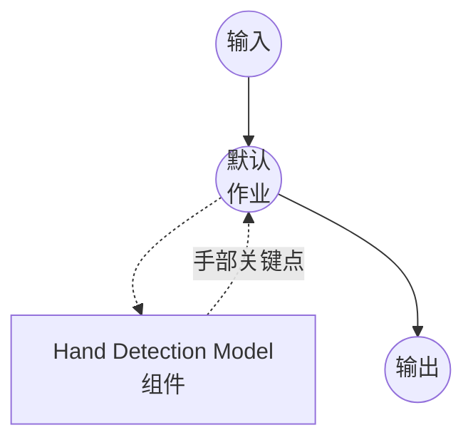

# 手部检测模型任务示例

此示例演示如何使用 model-compose 的内置 hand-detection 任务通过 MediaPipe Hand Landmarker 从图像中检测每只手 21 个关键点和左右手标识，提供离线手部分析能力。

## 概述

此工作流提供本地手部检测功能，包括：

1. **本地手部模型**：无需外部 API，在本地运行 Google 的 MediaPipe Hand Landmarker 模型
2. **每只手 21 个关键点**：手腕 + 每根手指（拇指/食指/中指/无名指/小指）4 个关节
3. **左右手标识**：将每只检测到的手标注为 `"Left"` 或 `"Right"`，并附带置信度评分
4. **2D 和 3D 关键点**：像素坐标以及可选的真实 3D 空间坐标（以手腕为中心，单位米）
5. **边界框**：从 21 个关键点派生的轴对齐边界框
6. **可选骨架图像**：可渲染每只手的骨架图像（natural HSV 布局或 OpenPose 风格的每指配色方案，适合用作 ControlNet Hand 输入）
7. **可选分割掩码**：可生成基于 convex hull 的"手部区域"掩码，用于 inpaint / ControlNet 管线
8. **多手检测**：默认最多检测两只手；提高 `max_detection_count` 可检测更多
9. **自动模型管理**：首次使用时自动下载和缓存模型

## 准备工作

### 前置条件

- 已安装 model-compose 并在 PATH 中可用
- 运行 MediaPipe 的足够系统资源（推荐：4GB+ RAM）
- 具有 `mediapipe` 和 `Pillow` 的 Python 环境（首次运行时自动安装）

### 为什么使用本地手部检测

与基于云的视觉 API 不同，在本地运行 MediaPipe Hand Landmarker 提供：

**本地处理的优势：**
- **隐私**：所有图像都在本地处理，不向外部服务发送数据
- **成本**：无按图像或 API 使用费用
- **离线**：初始模型下载后可在无互联网连接的情况下工作
- **延迟**：每次推理无网络往返
- **批量处理**：无速率限制的无限图像处理

**权衡：**
- **硬件要求**：CPU 友好，但实时视频仍需要足够资源
- **模型限制**：Hand Landmarker 对严重遮挡的手、极端角度、画面中非常小的手处理效果较差

### 环境配置

1. 导航到此示例目录：
   ```bash
   cd examples/model-tasks/hand-detection
   ```

2. 无需额外环境配置 — 模型和依赖会自动管理。

## 运行方法

1. **启动服务：**
   ```bash
   model-compose up
   ```

2. **运行工作流：**

   **使用 API：**
   ```bash
   # 基础手部检测（可见时两只手）
   curl -X POST http://localhost:8080/api/workflows/runs \
     -F "image=@/path/to/your/image.jpg" \
     -F "input={\"image\": \"@image\"}"

   # 包含 3D 关键点（以手腕为中心，米）
   curl -X POST http://localhost:8080/api/workflows/runs \
     -F "image=@/path/to/your/image.jpg" \
     -F "input={\"image\": \"@image\", \"return_keypoints_3d\": true}"

   # 检测两只以上的手（例如团体照）
   curl -X POST http://localhost:8080/api/workflows/runs \
     -F "image=@/path/to/your/image.jpg" \
     -F "input={\"image\": \"@image\", \"max_detection_count\": 4}"

   # 渲染 OpenPose 风格的骨架图像（可用作 ControlNet Hand 输入）
   curl -X POST http://localhost:8080/api/workflows/runs \
     -F "image=@/path/to/your/image.jpg" \
     -F "input={\"image\": \"@image\", \"return_skeleton_image\": true, \"skeleton_format\": \"openpose\"}"
   ```

   **使用 Web UI：**
   - 打开 Web UI：http://localhost:8081
   - 上传图像文件
   - 可选地调整 `max_detection_count`、`min_confidence` 以及 3D 关键点 / 裁剪边距切换
   - 点击 "Run Workflow" 按钮

   **使用 CLI：**
   ```bash
   # 基础手部检测
   model-compose run hand-detection --input '{"image": "/path/to/your/image.jpg"}'

   # 包含 3D 关键点
   model-compose run hand-detection --input '{"image": "/path/to/your/image.jpg", "return_keypoints_3d": true}'

   # 最多四只手
   model-compose run hand-detection --input '{"image": "/path/to/your/image.jpg", "max_detection_count": 4}'
   ```

## 组件详情

### Hand Detection Model 组件（默认）
- **类型**：带 hand-detection 任务的 Model 组件
- **目的**：从静态图像中检测每只手的关键点和左右手标识
- **驱动**：`custom`
- **系列**：`blazehand`
- **模型**：`hand_landmarker.task`（首次使用时从 Google MediaPipe 模型存储下载）
- **特性**：
  - 在 `~/.cache/mindor/models/mediapipe` 下自动下载和缓存模型
  - 每只检测到的手输出 21 个手部地标（手腕 + 每根手指 4 个关节 × 5）
  - 每只手的左右手标签（`Left` / `Right`）和置信度评分
  - 真实 3D 坐标（以手腕为中心，米单位）
  - 从可见关键点派生的轴对齐边界框，可通过 `crop_margin_ratio` 可选填充

### 模型信息：MediaPipe Hand Landmarker
- **开发者**：Google MediaPipe
- **类型**：设备端手部关键点检测
- **流水线**：掌心检测器 → 手部地标模型（捆绑在单个 `.task` 文件中）
- **地标**：每只手 21 个关键点
- **许可证**：Apache 2.0

## 工作流详情

### "Detect Hands from Image" 工作流（默认）

**描述**：使用 MediaPipe Hand Landmarker 从输入图像中检测每只手的 21 个地标和左右手标识。

#### 作业流程

此示例使用简化的单组件配置，不含显式作业。



#### 输入参数

| 参数 | 类型 | 必填 | 默认值 | 说明 |
|------|------|------|--------|------|
| `image` | image | 是 | - | 输入图像文件（JPEG、PNG 等） |
| `max_detection_count` | int | 否 | 2 | 每张图像检测的最大手数 |
| `min_confidence` | float | 否 | 0.5 | 掌心检测最小置信度（0.0 - 1.0） |
| `min_presence_confidence` | float | 否 | 0.5 | 关键点存在最小置信度（0.0 - 1.0） |
| `min_tracking_confidence` | float | 否 | 0.5 | 跟踪最小置信度（预留给未来视频模式） |
| `return_keypoints_3d` | bool | 否 | false | 包含真实 3D 关键点（以手腕为中心，米） |
| `return_segmentation_mask` | bool | 否 | false | 包含每只手的灰度掩码（21 个关键点的 convex hull） |
| `return_skeleton_image` | bool | 否 | false | 在透明画布上渲染每只手的骨架图像 |
| `skeleton_format` | string | 否 | `natural` | 骨架布局：`natural`（HSV 配色）或 `openpose`（每指配色方案，ControlNet 兼容） |
| `crop_margin_ratio` | float | 否 | 0.0 | 返回边界框周围添加的边距（相对于其自身宽/高的比例） |

#### 输出格式

| 字段 | 类型 | 说明 |
|------|------|------|
| `result.hands` | array | 检测到的手。每个条目始终包含 `handedness`、`handedness_score`、`bounding_box` 和（默认）`keypoints`；请求时也可包含 `keypoints_3d`、`segmentation_mask`、`skeleton_image` |
| `result.width` | int | 分析图像的宽度（像素） |
| `result.height` | int | 分析图像的高度（像素） |

每个手部条目：
- `handedness`：从模型视角的 `"Left"` 或 `"Right"`（相对于图像中的人物镜像）
- `handedness_score`：左右手分类的置信度（0.0 - 1.0）。这是模型唯一的逐手置信度 —— 没有逐关键点的 `visibility`/`presence`；Hand Landmarker 即使被遮挡也会回归全部 21 个点。
- `bounding_box`：`{x, y, width, height}` 像素坐标，从 21 个关键点派生（可通过 `crop_margin_ratio` 可选填充）
- `keypoints`：21 个条目，`x`、`y`（像素坐标）和 `z`（相对于手腕的深度；值越小越靠近相机）
- `keypoints_3d` *(可选)*：与 `keypoints` 相同 shape，真实米单位（以手腕为中心）
- `segmentation_mask` *(可选)*：填充 21 个关键点 convex hull 内部的 PNG 8 位掩码 —— 便宜的"手部区域"替代品，**并非真正的轮廓**
- `skeleton_image` *(可选)*：PNG 手部骨架图像（布局由 `skeleton_format` 决定）

## 系统要求

### 最低要求
- **RAM**：4GB（推荐 8GB+）
- **磁盘空间**：hand landmarker 模型约 10MB
- **CPU**：多核处理器
- **互联网**：仅初始模型下载需要

### 性能说明
- 首次运行下载 hand landmarker（~5MB）
- 模型加载需要几秒
- 不需要 GPU 加速；CPU 推理对于静态图像已足够快

## 自定义

### 使用本地下载的模型

```yaml
component:
  type: model
  task: hand-detection
  driver: custom
  family: blazehand
  model: ./models/hand_landmarker.task
```

### 一次检测更多手

```yaml
component:
  action:
    image: ${input.image as image}
    max_detection_count: 6
    params:
      min_confidence: 0.4
```

### 启用 3D 关键点

设置 `return_keypoints_3d: true` 可获得以手腕为中心的米单位 3D 坐标。对于将手指关节映射到 3D 绑定角色或独立于相机距离计算手指弯曲角度非常有用。

```yaml
component:
  action:
    image: ${input.image as image}
    return_keypoints_3d: true
```

### 为 ControlNet 渲染骨架图像

将 `skeleton_format: openpose` 设置为将 21 点手部以每指配色方案（拇指=红、食指=橙、中指=黄、无名指=绿、小指=蓝）渲染到透明画布上。与 `return_skeleton_image: true` 配合，将 `hands[i].skeleton_image` 直接传递给 ControlNet Hand 预处理器/模型。

```yaml
component:
  action:
    image: ${input.image as image}
    return_keypoints: false
    return_skeleton_image: true
    skeleton_format: openpose
    output: ${result.hands[0].skeleton_image}
```

对于调试式可视化，保持默认的 `skeleton_format: natural` —— 它使用 HSV 配色，使每个关节/肢段都在视觉上可区分。

### 生成 Inpaint 掩码

从 21 个关键点 convex hull 合成的掩码是覆盖手腕 + 手指尖端的凸多边形，手指间的缝隙会合并为一个区域。在不需要精确轮廓的 inpaint / ControlNet 管线中，可用作"仅在手内绘制"的粗略掩码。

```yaml
component:
  action:
    image: ${input.image as image}
    return_keypoints: false
    return_segmentation_mask: true
    output: ${result.hands[0].segmentation_mask}
```

### 与 `pose-detection` 配合使用

Hand Landmarker 独立于 `pose-detection` 运行；MediaPipe 不会重用 pose 的手腕位置来约束手部检测范围。要在一个工作流中同时获得身体 + 手指，需要在同一张图像上运行两个组件，然后通过比较手的手腕关键点（index 0）与 pose 的手腕关键点（BlazePose 中 index 15 / 16 对应左/右）来匹配每只手与 pose。未匹配的手可以丢弃；没有匹配到手的 pose 则简单地省略手指地标。

## 故障排除

### 常见问题

1. **模型下载失败**：检查互联网连接和 `storage.googleapis.com` 的可访问性
2. **`mediapipe` 导入错误**：确保 Python 3.9+；重新运行 `model-compose up` 以安装设置要求
3. **未检测到手**：降低 `min_confidence`，确认手未被裁掉，或尝试更高分辨率的输入
4. **左右手颠倒**：`handedness` 是从模型视角报告的，相对于图像中的人物是镜像的 —— 这是设计行为，不是 bug

### 性能优化

- **图像预处理**：提交前降采样非常大的图像 —— Hand Landmarker 对约 1024px 以上分辨率没有收益
- **置信度阈值**：提高 `min_confidence` 减少假阳性，但对部分可见的手的召回率降低
