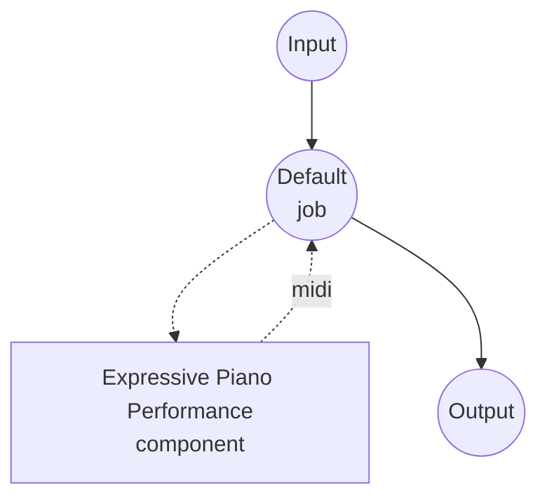

# 표현 피아노 연주 모델 태스크 예제 (VirtuosoNet)

이 예제는 VirtuosoNet을 사용하여 MusicXML 피아노 악보를 표현력 있는 MIDI 연주로 렌더링하는 방법을 보여주며, model-compose의 내장 모델 태스크 기능을 통해 로컬에서 실행됩니다.

## 개요

이 워크플로우는 평평한 MusicXML 악보를 사람 같은 MIDI 연주로 변환합니다:

1. **로컬 모델 실행**: 외부 API 없이 VirtuosoNet(HAN+GRU 그래프-RNN)을 로컬에서 실행
2. **표현적 타이밍**: 악보로부터 템포 루바토, 아고긱 악센트, 리타르단도 곡선을 추론
3. **다이내믹 조형**: 콩쿠르 수준 피아니스트를 모델링한 음표 단위 벨로시티
4. **페달 렌더링**: 생성된 프레이징에 맞춰 서스테인 페달(CC64) 적용
5. **작곡가 조건부 생성**: 작곡가 스타일을 선택해 프레이징, 템포 변화, 페달 사용을 편향

## 준비사항

### 필수 요구사항

- model-compose가 설치되어 PATH에서 사용 가능
- NVIDIA GPU, Apple Silicon Mac, 또는 CPU (VirtuosoNet은 CPU에서 실행할 수 있을 만큼 작음)
- 렌더링할 MusicXML 파일 (`.musicxml` 또는 `.xml`; 압축된 `.mxl`은 지원하지 않음 — 먼저 압축 해제 필요)
- virtuosonet과 의존성이 포함된 Python 환경 (자동 관리)

### 환경 구성

1. 이 예제 디렉토리로 이동:
   ```bash
   cd examples/model-tasks/music-performance-virtuoso-net
   ```

2. 추가 환경 구성이 필요 없습니다 — 사전학습 체크포인트는 첫 실행 시 HuggingFace Hub에서 자동으로 다운로드됩니다.

## 실행 방법

1. **서비스 시작:**
   ```bash
   model-compose up
   ```

2. **워크플로우 실행:**

   **API 사용:**
   ```bash
   curl -X POST http://localhost:8080/api/workflows/runs \
     -H "Content-Type: multipart/form-data" \
     -F 'input.score=@./score.musicxml' \
     -F 'input.composer=Chopin' \
     -F 'input.bool_pedal=true'
   ```

   **웹 UI 사용:**
   - 웹 UI 열기: http://localhost:8081
   - `score`에 MusicXML 파일 업로드
   - `composer` 선택 (기본값 `Chopin`)
   - 필요 시 `bool_pedal` 또는 `disklavier` 토글
   - "Run Workflow" 버튼 클릭

   **CLI 사용:**
   ```bash
   model-compose run --input '{"score": "./score.musicxml", "composer": "Chopin", "bool_pedal": true}'
   ```

   응답은 표현적인 연주가 담긴 MIDI 파일(`audio/midi`)입니다.

## 컴포넌트 세부사항

### 표현 피아노 연주 모델 컴포넌트 (기본)
- **유형**: music-performance 태스크를 가진 모델 컴포넌트
- **목적**: MusicXML 악보를 표현력 있는 MIDI 연주로 렌더링
- **모델**: dasaem/virtuosonet (HuggingFace Hub)
- **드라이버**: custom (VirtuosoNet 계열)
- **디바이스**: auto (CPU로 충분; 가능하면 GPU 사용)
- **동시성**: 1 (한 번에 하나의 요청)

### 모델 정보: VirtuosoNet
- **개발자**: Dasaem Jeong 외 (KAIST MAC Lab)
- **유형**: 계층적 어텐션 + 그래프-RNN 연주 렌더러
- **입력 형식**: MusicXML (비압축)
- **출력 형식**: MIDI (SMF Type 1, CC64 페달 포함)
- **학습 데이터**: 악보에 정렬된 콩쿠르 수준의 피아노 녹음

## 워크플로우 세부사항

### "Expressive Piano Performance" 워크플로우 (기본)

**설명**: VirtuosoNet을 사용하여 MusicXML 피아노 악보를 표현력 있는 MIDI 연주로 렌더링합니다.

#### 작업 흐름



#### 입력 파라미터

| 파라미터 | 유형 | 필수 | 기본값 | 설명 |
|---------|------|------|--------|------|
| `score` | file | 예 | - | 렌더링할 MusicXML 악보 |
| `composer` | text | 아니오 | `Chopin` | 작곡가 스타일 조건부 생성 (아래 목록 참조) |
| `bool_pedal` | boolean | 아니오 | `false` | 0이 아닌 값을 모두 서스테인-온으로 처리하는 플레이어를 위해 CC64를 on/off로 임계값 처리 |
| `disklavier` | boolean | 아니오 | `false` | Yamaha Disklavier 재생에 맞춘 MIDI 출력 |

지원 작곡가: `Bach`, `Balakirev`, `Beethoven`, `Brahms`, `Chopin`, `Debussy`, `Glinka`, `Haydn`, `Liszt`, `Mozart`, `Prokofiev`, `Rachmaninoff`, `Ravel`, `Schubert`, `Schumann`, `Scriabin`. 상위 모델은 학습 데이터 커버리지가 가장 강한 작곡가로 `Bach`, `Beethoven`, `Chopin`, `Haydn`, `Liszt`, `Mozart`, `Ravel`, `Schubert`를 권장합니다.

#### 출력 형식

| 필드 | 유형 | 설명 |
|------|------|------|
| - | file | 생성된 연주 MIDI (`audio/midi`) |

## 시스템 요구사항

### 최소 요구사항
- **GPU**: 선택사항 (CPU로도 추론 가능)
- **RAM**: 4GB+
- **디스크 공간**: 체크포인트 약 500MB
- **인터넷**: 초기 모델 다운로드 시에만 필요

### 성능 참고사항
- 첫 실행 시 HuggingFace Hub에서 체크포인트(~400MB)를 다운로드합니다
- 3분 분량 악보가 최신 CPU에서 1분 이내에 렌더링됩니다
- MusicXML 파일은 비압축(`.musicxml` 또는 `.xml`)이어야 하며, `.mxl` 파일은 업로드 전에 압축을 풀어야 합니다

## 커스터마이징

### 초기 템포 재정의

`qpm_primo`를 전달하여 악보 고유 템포(QPM)를 재정의할 수 있습니다:

```yaml
action:
  params:
    qpm_primo: 72.0
```

### 멀티 트랙 출력과 템포 클럭

각 MusicXML 파트를 별도의 MIDI 트랙으로 분리하고, 시퀀서 정렬용 템포 클럭 트랙을 추가:

```yaml
action:
  params:
    multi_instruments: true
    tempo_clock: true
    clock_interval_in_16th: 4
```

### GPU 사용

```yaml
component:
  device: cuda:0   # Apple Silicon에서는 "mps"
```

## 관련 예제

- **[music-generation](../music-generation/)**: ACE-Step으로 텍스트 설명으로부터 음악 생성
- **[music-transcription](../music-transcription/)**: 오디오를 음표와 MIDI로 전사
