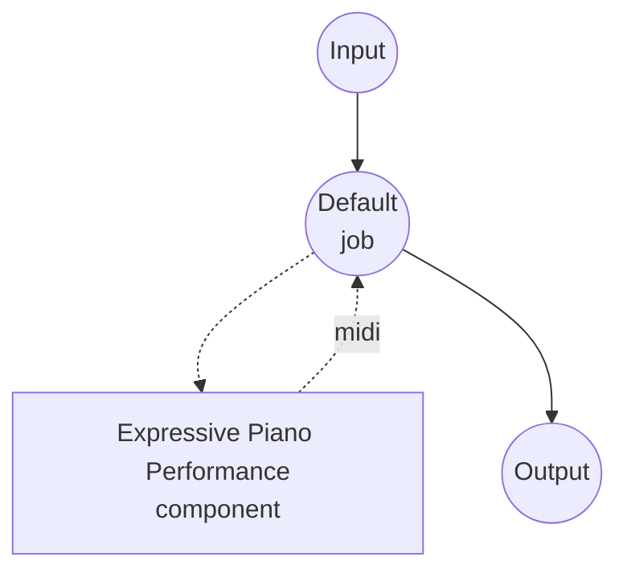

# Expressive Piano Performance Model Task Example (VirtuosoNet)

This example demonstrates how to render a MusicXML piano score into an expressive MIDI performance using VirtuosoNet, running locally via model-compose's built-in model task functionality.

## Overview

This workflow turns a flat MusicXML score into a human-like MIDI performance that captures:

1. **Local Model Execution**: Runs VirtuosoNet (HAN+GRU graph-RNN) locally without external APIs
2. **Expressive Timing**: Tempo rubato, agogic accents, and ritardando curves inferred from the score
3. **Dynamic Shaping**: Note-level velocities modeled after competition-grade pianists
4. **Pedal Rendering**: Sustain pedal (CC64) applied in time with the generated phrasing
5. **Composer Conditioning**: Choose a composer style to bias phrasing, tempo variance, and pedal usage

## Preparation

### Prerequisites

- model-compose installed and available in your PATH
- NVIDIA GPU, Apple Silicon Mac, or CPU (VirtuosoNet is small enough to run on CPU)
- A MusicXML file to render (`.musicxml` or `.xml`; compressed `.mxl` is not supported — unzip first)
- Python environment with virtuosonet and its dependencies (automatically managed)

### Environment Configuration

1. Navigate to this example directory:
   ```bash
   cd examples/model-tasks/music-performance-virtuoso-net
   ```

2. No additional environment configuration required — the pretrained checkpoint is downloaded automatically from the HuggingFace Hub on first run.

## How to Run

1. **Start the service:**
   ```bash
   model-compose up
   ```

2. **Run the workflow:**

   **Using API:**
   ```bash
   curl -X POST http://localhost:8080/api/workflows/runs \
     -H "Content-Type: multipart/form-data" \
     -F 'input.score=@./score.musicxml' \
     -F 'input.composer=chopin' \
     -F 'input.bool_pedal=true'
   ```

   **Using Web UI:**
   - Open the Web UI: http://localhost:8081
   - Upload a MusicXML file as `score`
   - Pick a `composer` (defaults to `chopin`)
   - Toggle `bool_pedal` or `disklavier` as needed
   - Click the "Run Workflow" button

   **Using CLI:**
   ```bash
   model-compose run --input '{"score": "./score.musicxml", "composer": "chopin", "bool_pedal": true}'
   ```

   The response is a MIDI file (`audio/midi`) containing the expressive performance.

## Component Details

### Expressive Piano Performance Model Component (Default)
- **Type**: Model component with music-performance task
- **Purpose**: Render a MusicXML score as an expressive MIDI performance
- **Model**: dasaem/virtuosonet (HuggingFace Hub)
- **Driver**: custom (VirtuosoNet family)
- **Device**: auto (CPU is sufficient; GPU is used if available)
- **Concurrency**: 1 (single request at a time)

### Model Information: VirtuosoNet
- **Developer**: Dasaem Jeong et al. (KAIST MAC Lab)
- **Type**: Hierarchical attention + graph-RNN performance renderer
- **Input Format**: MusicXML (uncompressed)
- **Output Format**: MIDI (SMF Type 1, CC64 pedal baked in)
- **Training Data**: Competition-grade piano recordings aligned to scores

## Workflow Details

### "Expressive Piano Performance" Workflow (Default)

**Description**: Render a MusicXML piano score into an expressive MIDI performance using VirtuosoNet.

#### Job Flow



#### Input Parameters

| Parameter | Type | Required | Default | Description |
|-----------|------|----------|---------|-------------|
| `score` | file | Yes | - | MusicXML score to render |
| `composer` | text | No | `chopin` | Composer style conditioning (see list below) |
| `bool_pedal` | boolean | No | `false` | Threshold CC64 to on/off for players that treat any non-zero value as sustain-on |
| `disklavier` | boolean | No | `false` | Emit MIDI tuned for Yamaha Disklavier playback |

Supported composers: `bach`, `balakirev`, `beethoven`, `brahms`, `chopin`, `debussy`, `glinka`, `haydn`, `liszt`, `mozart`, `prokofiev`, `rachmaninoff`, `ravel`, `schubert`, `schumann`, `scriabin`. The upstream model recommends `bach`, `beethoven`, `chopin`, `haydn`, `liszt`, `mozart`, `ravel`, and `schubert` as the composers with the strongest training coverage.

#### Output Format

| Field | Type | Description |
|-------|------|-------------|
| - | file | Generated performance MIDI (`audio/midi`) |

## System Requirements

### Minimum Requirements
- **GPU**: Optional (CPU is sufficient for inference)
- **RAM**: 4GB+
- **Disk Space**: ~500MB for the checkpoint
- **Internet**: Required for initial model download only

### Performance Notes
- First run downloads the checkpoint (~400MB) from HuggingFace Hub
- A 3-minute score renders in under a minute on a modern CPU
- MusicXML files must be uncompressed (`.musicxml` or `.xml`); unzip `.mxl` files before uploading

## Customization

### Overriding Initial Tempo

Pass `qpm_primo` to override the score's native tempo (quarters per minute):

```yaml
action:
  params:
    qpm_primo: 72.0
```

### Multi-Track Output and Tempo Clock

Separate each MusicXML part into its own MIDI track, and add a tempo clock track for sequencer alignment:

```yaml
action:
  params:
    multi_instruments: true
    tempo_clock: true
    clock_interval_in_16th: 4
```

### Using GPU

```yaml
component:
  device: cuda:0   # or "mps" on Apple Silicon
```

## Related Examples

- **[music-generation](../music-generation/)**: Generate music from text descriptions with ACE-Step
- **[music-transcription](../music-transcription/)**: Transcribe audio into notes and MIDI
