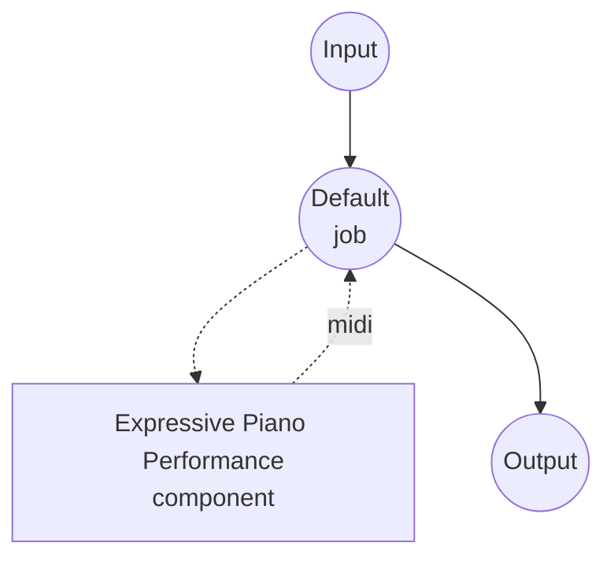

# 表现性钢琴演奏模型任务示例 (VirtuosoNet)

此示例演示如何使用 VirtuosoNet 将 MusicXML 钢琴乐谱渲染为富有表现力的 MIDI 演奏，通过 model-compose 的内置模型任务功能在本地运行。

## 概述

此工作流将平淡的 MusicXML 乐谱转换为类人的 MIDI 演奏：

1. **本地模型执行**：无需外部 API，在本地运行 VirtuosoNet (HAN+GRU 图-RNN)
2. **表现性时值**：从乐谱推断速度自由节奏、变化重音和渐慢曲线
3. **力度塑形**：按比赛级钢琴家建模的音符级力度
4. **踏板渲染**：延音踏板 (CC64) 与生成的乐句结构同步应用
5. **作曲家条件生成**：选择作曲家风格以影响乐句、速度变化和踏板使用

## 准备工作

### 前置条件

- 已安装 model-compose 并在您的 PATH 中可用
- NVIDIA GPU、Apple Silicon Mac 或 CPU（VirtuosoNet 足够小，可在 CPU 上运行）
- 要渲染的 MusicXML 文件（`.musicxml` 或 `.xml`；不支持压缩的 `.mxl` — 请先解压）
- 包含 virtuosonet 及其依赖的 Python 环境（自动管理）

### 环境配置

1. 导航到此示例目录：
   ```bash
   cd examples/model-tasks/music-performance-virtuoso-net
   ```

2. 无需额外的环境配置 — 预训练检查点将在首次运行时从 HuggingFace Hub 自动下载。

## 运行方式

1. **启动服务：**
   ```bash
   model-compose up
   ```

2. **运行工作流：**

   **使用 API：**
   ```bash
   curl -X POST http://localhost:8080/api/workflows/runs \
     -H "Content-Type: multipart/form-data" \
     -F 'input.score=@./score.musicxml' \
     -F 'input.composer=Chopin' \
     -F 'input.bool_pedal=true'
   ```

   **使用 Web UI：**
   - 打开 Web UI：http://localhost:8081
   - 上传 MusicXML 文件作为 `score`
   - 选择 `composer`（默认 `Chopin`）
   - 根据需要切换 `bool_pedal` 或 `disklavier`
   - 点击 "Run Workflow" 按钮

   **使用 CLI：**
   ```bash
   model-compose run --input '{"score": "./score.musicxml", "composer": "Chopin", "bool_pedal": true}'
   ```

   响应是包含表现性演奏的 MIDI 文件 (`audio/midi`)。

## 组件详情

### 表现性钢琴演奏模型组件（默认）
- **类型**：带有 music-performance 任务的模型组件
- **用途**：将 MusicXML 乐谱渲染为富有表现力的 MIDI 演奏
- **模型**：dasaem/virtuosonet (HuggingFace Hub)
- **驱动**：custom (VirtuosoNet 系列)
- **设备**：auto（CPU 足够；如有 GPU 则使用 GPU）
- **并发**：1（一次一个请求）

### 模型信息：VirtuosoNet
- **开发者**：Dasaem Jeong 等（KAIST MAC 实验室）
- **类型**：层次注意力 + 图-RNN 演奏渲染器
- **输入格式**：MusicXML（未压缩）
- **输出格式**：MIDI（SMF Type 1，内嵌 CC64 踏板）
- **训练数据**：对齐到乐谱的比赛级钢琴录音

## 工作流详情

### "Expressive Piano Performance" 工作流（默认）

**描述**：使用 VirtuosoNet 将 MusicXML 钢琴乐谱渲染为富有表现力的 MIDI 演奏。

#### 作业流程



#### 输入参数

| 参数 | 类型 | 必需 | 默认值 | 描述 |
|------|------|------|--------|------|
| `score` | file | 是 | - | 要渲染的 MusicXML 乐谱 |
| `composer` | text | 否 | `Chopin` | 作曲家风格条件化（见下方列表） |
| `bool_pedal` | boolean | 否 | `false` | 对于将任何非零值视为延音开启的播放器，将 CC64 阈值化为开/关 |
| `disklavier` | boolean | 否 | `false` | 发出针对 Yamaha Disklavier 播放调整的 MIDI |

支持的作曲家：`Bach`、`Balakirev`、`Beethoven`、`Brahms`、`Chopin`、`Debussy`、`Glinka`、`Haydn`、`Liszt`、`Mozart`、`Prokofiev`、`Rachmaninoff`、`Ravel`、`Schubert`、`Schumann`、`Scriabin`。上游模型推荐训练数据覆盖最强的作曲家：`Bach`、`Beethoven`、`Chopin`、`Haydn`、`Liszt`、`Mozart`、`Ravel` 和 `Schubert`。

#### 输出格式

| 字段 | 类型 | 描述 |
|------|------|------|
| - | file | 生成的演奏 MIDI (`audio/midi`) |

## 系统要求

### 最低要求
- **GPU**：可选（CPU 足以推理）
- **RAM**：4GB+
- **磁盘空间**：检查点约 500MB
- **互联网**：仅初始模型下载时需要

### 性能说明
- 首次运行时从 HuggingFace Hub 下载检查点（约 400MB）
- 3 分钟的乐谱在现代 CPU 上渲染时间不到 1 分钟
- MusicXML 文件必须未压缩（`.musicxml` 或 `.xml`）；上传前请解压 `.mxl` 文件

## 自定义

### 覆盖初始速度

传递 `qpm_primo` 以覆盖乐谱固有的速度（每分钟四分音符数）：

```yaml
action:
  params:
    qpm_primo: 72.0
```

### 多轨道输出和速度时钟

将每个 MusicXML 声部分离到独立的 MIDI 轨道，并添加用于音序器对齐的速度时钟轨道：

```yaml
action:
  params:
    multi_instruments: true
    tempo_clock: true
    clock_interval_in_16th: 4
```

### 使用 GPU

```yaml
component:
  device: cuda:0   # Apple Silicon 上使用 "mps"
```

## 相关示例

- **[music-generation](../music-generation/)**：使用 ACE-Step 从文本描述生成音乐
- **[music-transcription](../music-transcription/)**：将音频转录为音符和 MIDI
