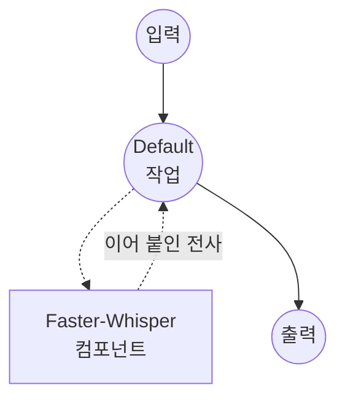

# Speech-to-Text Faster-Whisper Model Task 예제

이 예제는 Faster-Whisper를 사용하여 긴 오디오 파일을 하나의 일반 텍스트 전사로 변환하는 방법을 보여줍니다. Faster-Whisper는 OpenAI Whisper를 CTranslate2로 재구현한 포팅으로, 기본 HuggingFace 포팅보다 눈에 띄게 빠르고 메모리 사용량이 적습니다.

## 개요

이 워크플로우는 다음과 같은 로컬 음성-텍스트 변환을 제공합니다:

1. **장시간 오디오**: 길이 제한 없이 오디오를 입력받으며, Faster-Whisper가 내부적으로 30초 디코딩 윈도우를 오디오 파형 위로 슬라이딩하면서 세그먼트를 다시 하나의 전사로 이어 붙입니다
2. **단일 텍스트 출력**: 전체 전사를 일반 문자열로 반환하여 `.txt` 파일로 바로 저장할 수 있습니다
3. **VAD 사전 필터**: 디코딩 전에 Silero VAD가 무음 구간을 건너뛰어, 공백이 많은 장시간 녹음에서 환각 텍스트를 줄입니다
4. **문맥 이어가기**: 이전 세그먼트의 텍스트가 다음 윈도우에 프롬프트로 전달되어, 청크 경계에서도 구두점과 스타일이 일관되게 유지됩니다
5. **전사 또는 번역**: 원본 언어를 유지하거나 호출 시점에 영어로 번역하도록 전환할 수 있습니다
6. **로컬 모델 실행**: `faster-whisper` / CTranslate2를 통해 완전히 오프라인으로 실행

장시간 오디오 이어 붙이기가 Faster-Whisper 내부에서 처리되므로, `audio-clipper`나 셸 전처리로 파일을 직접 쪼갤 **필요가 없습니다** — 전체 오디오를 그대로 전달하면 전체 전사가 반환됩니다.

## 준비사항

### 필수 요구사항

- model-compose가 설치되어 PATH에서 사용 가능
- Faster-Whisper 실행을 위한 충분한 시스템 리소스 (권장: 8GB+ RAM, `large-v3`에는 GPU 권장)
- `faster-whisper`, `torch`, `torchaudio`, `numpy`, `soxr`가 있는 Python 환경 (자동 관리)

### Faster-Whisper를 사용하는 이유

기본 Whisper와 비교했을 때, Faster-Whisper는 처리량에 집중한 드롭인 대체 구현입니다:

**이점:**
- **속도**: 동일한 품질 수준에서 HuggingFace Whisper 포팅보다 보통 2–4배 빠름
- **낮은 메모리**: `int8`, `int8_float16` 계산 타입으로 큰 품질 손실 없이 VRAM/RAM 사용량을 줄임
- **내장 장시간 처리**: `chunk_length`가 수 분에서 수 시간 분량의 오디오를 수동 분할 없이 처리
- **내장 VAD**: Silero VAD로 무음을 건너뛰어 연산량과 환각을 추가로 감소시킴
- **프라이버시**: 모든 오디오 처리가 로컬에서 이루어지며 외부로 데이터 전송 없음

**트레이드오프:**
- **설정**: 첫 실행 시 원본 Whisper 체크포인트가 아닌 Faster-Whisper 가중치(CTranslate2 포맷)를 다운로드
- **단어 타임스탬프**: 지원되지만 옵트인 방식이며, 이 예제에서는 깔끔한 텍스트 문자열을 반환하도록 꺼둡니다

### 환경 구성

1. 이 예제 디렉토리로 이동:
   ```bash
   cd examples/model-tasks/speech-to-text-faster-whisper
   ```

2. 추가 환경 구성 불필요 - 모델 및 종속성이 자동으로 관리됩니다.

## 실행 방법

1. **서비스 시작:**
   ```bash
   model-compose up
   ```

2. **워크플로우 실행:**

   **API 사용:**
   ```bash
   # 자동 언어 감지, 원본 언어로 전사
   curl -X POST http://localhost:8080/api/workflows/runs \
     -F "audio=@/path/to/long-audio.mp3" \
     -F 'input={"audio": "@audio"}'

   # 한국어 명시, 영어로 번역
   curl -X POST http://localhost:8080/api/workflows/runs \
     -F "audio=@/path/to/long-audio.mp3" \
     -F 'input={"audio": "@audio", "language": "ko", "task": "translate"}'
   ```

   **웹 UI 사용:**
   - 웹 UI 열기: http://localhost:8081
   - 오디오 파일 업로드 (MP3, WAV, FLAC, M4A 등)
   - 선택적으로 `language` 설정 (예: `en`, `ko`, `ja`); 비워두면 자동 감지
   - `task` 선택: `transcribe`(원본 언어 유지) 또는 `translate`(영어로 출력)
   - "Run Workflow" 버튼 클릭

   **CLI 사용:**
   ```bash
   # 간단한 전사, 전사 결과를 바로 파일로 저장
   model-compose run --input '{"audio": "/path/to/long-audio.mp3"}' \
     | jq -r '.transcription' > transcript.txt
   ```

## 컴포넌트 세부사항

### Speech to Text Model 컴포넌트 (기본)
- **유형**: speech-to-text 작업을 사용하는 Model 컴포넌트
- **목적**: Faster-Whisper를 사용한 로컬 장시간 오디오 전사
- **모델**: `Systran/faster-whisper-large-v3`
- **Family**: faster-whisper
- **기능**:
  - 자동 모델 다운로드 및 캐싱
  - 장시간 오디오를 위한 내부 30초 청킹
  - 선택적인 Silero VAD 사전 필터
  - `condition_on_previous_text`를 통한 청크 간 문맥 이어가기
  - CPU 및 GPU 가속

### 모델 정보: Faster-Whisper
- **개발자**: SYSTRAN (OpenAI Whisper를 CTranslate2로 포팅)
- **기본 아키텍처**: Whisper
- **사용 가능한 변형**: `Systran/faster-whisper-tiny`, `-base`, `-small`, `-medium`, `-large-v2`, `-large-v3`, `-distil-large-v3`
- **기능**: 다국어 전사, 영어 번역, 세그먼트 및 단어 수준 타임스탬프

## 워크플로우 세부사항

### "Speech to Text (Faster-Whisper)" 워크플로우 (기본)

**설명**: 로컬 Faster-Whisper 모델로 긴 오디오 파일을 하나의 전사로 변환합니다.

#### 작업 흐름

이 예제는 명시적인 작업 없이 단순화된 단일 컴포넌트 구성을 사용합니다.



#### 입력 매개변수

| 매개변수 | 유형 | 필수 | 기본값 | 설명 |
|---------|------|------|--------|------|
| `audio` | audio | 예 | - | 입력 오디오 파일 (MP3, WAV, FLAC, M4A 등); 길이 제한 없음 |
| `language` | text | 아니오 | *(자동)* | BCP-47 언어 코드 (예: `en`, `ko`, `ja`); 생략 시 자동 감지 |
| `task` | text | 아니오 | `transcribe` | `transcribe`는 원본 언어 유지, `translate`는 영어로 출력 |

#### 출력 형식

| 필드 | 유형 | 설명 |
|-----|------|------|
| `transcription` | text | 전체 전사를 하나의 일반 텍스트 문자열로 제공 |

## 시스템 요구사항

### 최소 요구사항
- **RAM**: 8GB (`large-v3`에는 16GB+ 권장)
- **VRAM**: `large-v3`에는 6GB+ GPU 권장
- **디스크 공간**: 모델 및 캐시를 위한 3GB+
- **CPU**: 멀티코어 프로세서 (CPU 전용 실행 시 4+ 코어 권장)
- **인터넷**: 초기 모델 다운로드에만 필요

### 성능 참고사항
- 첫 실행 시 CTranslate2 가중치 다운로드 (`large-v3` 기준 약 3GB)
- 모델 로딩은 하드웨어에 따라 10–30초 소요
- GPU 가속으로 추론 속도가 크게 향상됨
- `int8`, `int8_float16` 계산 타입은 약간의 품질 손실로 큰 메모리 절감을 얻을 수 있음

## 사용자 정의

### 더 작거나 빠른 모델 선택

더 작은 변형을 선택하여 품질을 속도와 교환:

```yaml
component:
  type: model
  task: speech-to-text
  driver: custom
  family: faster-whisper
  model: Systran/faster-whisper-distil-large-v3   # 또는 ...-medium, ...-small, ...-base, ...-tiny
```

### GPU에서 실행

기본 구성은 `device: auto`를 사용합니다. GPU가 있을 때는 CUDA로 고정:

```yaml
component:
  type: model
  task: speech-to-text
  driver: custom
  family: faster-whisper
  model: Systran/faster-whisper-large-v3
  device: cuda:0
  compute_type: float16
```

### 일반 텍스트 대신 타임스탬프 반환

`return_timestamps`를 켜면 `start_time`, `end_time`, `text`를 담은 세그먼트 JSON 리스트를 받을 수 있습니다:

```yaml
workflow:
  job:
    input: ${input}
    output:
      transcription: ${output as json}

component:
  action:
    audio: ${input.audio as audio}
    chunk_length: 30
    return_timestamps: true
    timestamp_level: segment     # 단어별 타이밍은 'word'
```

### 장시간 파이프라인 튜닝

길거나 잡음이 많은 녹음에 가장 유용한 노브:

```yaml
component:
  action:
    audio: ${input.audio as audio}
    chunk_length: 30                       # 디코딩 윈도우 길이(초)
    params:
      vad_filter: true                     # Silero VAD로 무음 구간 건너뛰기
      condition_on_previous_text: true     # 청크 경계에서 문맥 유지
      vad_parameters:
        min_silence_duration_ms: 2000      # 2초 미만의 무음은 병합
        speech_pad_ms: 400                 # 각 음성 구간 주변 패딩
```

## 문제 해결

### 일반적인 문제

1. **메모리 부족**: 더 작은 변형(`distil-large-v3`, `medium`, `small`) 사용 또는 `compute_type: int8` / `int8_float16` 설정
2. **모델 다운로드 실패**: 인터넷 연결 및 디스크 공간 확인
3. **CPU에서 느린 처리**: `vad_filter: true`로 무음 건너뛰기를 활성화하고 `large-v3`보다 `distil-large-v3`나 `medium`을 선호
4. **무음에서 환각 텍스트**: `vad_filter: true` 활성화, `params.no_speech_threshold`를 `0.8` 쪽으로 올리기
5. **긴 무음 뒤 반복 루프**: `condition_on_previous_text: false` 설정

### 성능 최적화

- **장치**: 가장 큰 속도 향상을 위해 `cuda:0` + `compute_type: float16`
- **계산 타입**: GPU에서는 `int8_float16`, CPU에서는 `int8`이 약간의 품질 손실로 큰 메모리 절감 제공
- **언어 지정**: `language`를 명시적으로 설정하면 자동 감지를 건너뛰어 속도와 정확도가 모두 향상됨
- **VAD**: `vad_filter: true`는 긴 무음 구간이 있는 녹음에서 디코딩 시간을 크게 줄일 수 있음

## 관련 예제

- [speech-to-text](../speech-to-text) — HuggingFace transformers 기반 기본 Whisper
- [speech-to-text-crisper-whisper](../speech-to-text-crisper-whisper) — 단어 수준 타임스탬프를 포함한 축어적 전사
- [speech-to-text-vibevoice](../speech-to-text-vibevoice) — 화자 식별 포함 장시간 전사
- [speech-to-text-vibevoice-streaming](../speech-to-text-vibevoice-streaming) — 청크 단위 스트리밍 전사
