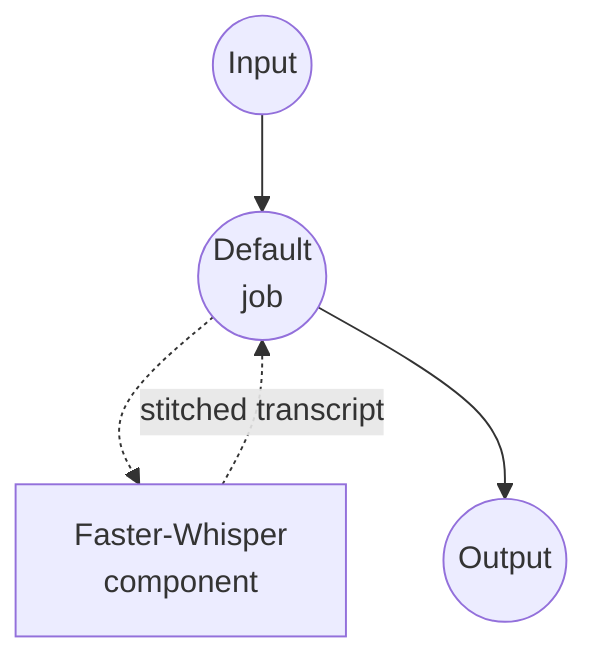

# Speech-to-Text Faster-Whisper Model Task Example

This example demonstrates how to transcribe long audio files into a single plain-text transcript using Faster-Whisper, a CTranslate2 reimplementation of OpenAI's Whisper that is noticeably faster and lighter on memory than the stock HuggingFace port.

## Overview

This workflow provides local speech-to-text transcription that:

1. **Long-form Audio**: Accepts audio of any length; Faster-Whisper slides a 30-second decoding window across the waveform internally and stitches the segments back into one transcript
2. **Single Text Output**: Returns the full transcript as a plain string, ready to save to a `.txt` file
3. **VAD Pre-filter**: Silero VAD skips silent regions before decoding, which reduces hallucinated text on long recordings with gaps
4. **Context Carryover**: Prior-segment text is fed as a prompt to the next window, keeping punctuation and style consistent across chunk boundaries
5. **Transcribe or Translate**: Switch between keeping the source language and translating into English at call time
6. **Local Model Execution**: Runs entirely offline via `faster-whisper` / CTranslate2

Because long-form stitching happens inside Faster-Whisper, you do **not** need to split the file yourself with `audio-clipper` or a shell preprocess — pass the full audio in and get the full transcript back.

## Preparation

### Prerequisites

- model-compose installed and available in your PATH
- Sufficient system resources for running Faster-Whisper (recommended: 8GB+ RAM; GPU recommended for `large-v3`)
- Python environment with `faster-whisper`, `torch`, `torchaudio`, `numpy`, and `soxr` (automatically managed)

### Why Faster-Whisper

Compared to stock Whisper, Faster-Whisper is a drop-in replacement focused on throughput:

**Benefits:**
- **Speed**: Typically 2–4× faster than the HuggingFace Whisper port at matched quality
- **Lower Memory**: `int8` and `int8_float16` compute types shrink VRAM/RAM footprint without a large quality hit
- **Built-in Long-form**: `chunk_length` handles multi-minute or multi-hour audio without manual splitting
- **Built-in VAD**: Silero VAD can skip silence to further reduce compute and hallucinations
- **Privacy**: All audio processing happens locally; no data leaves the machine

**Trade-offs:**
- **Setup**: First run downloads the Faster-Whisper weights (CTranslate2 format), not the original Whisper checkpoints
- **Word Timestamps**: Supported but opt-in; this example keeps them off to return a clean text string

### Environment Configuration

1. Navigate to this example directory:
   ```bash
   cd examples/model-tasks/speech-to-text-faster-whisper
   ```

2. No additional environment configuration is required — the model and its dependencies are managed automatically.

## How to Run

1. **Start the service:**
   ```bash
   model-compose up
   ```

2. **Run the workflow:**

   **Using API:**
   ```bash
   # Auto language detection, transcribe in source language
   curl -X POST http://localhost:8080/api/workflows/runs \
     -F "audio=@/path/to/long-audio.mp3" \
     -F 'input={"audio": "@audio"}'

   # Explicit Korean, translate to English
   curl -X POST http://localhost:8080/api/workflows/runs \
     -F "audio=@/path/to/long-audio.mp3" \
     -F 'input={"audio": "@audio", "language": "ko", "task": "translate"}'
   ```

   **Using Web UI:**
   - Open the Web UI: http://localhost:8081
   - Upload an audio file (MP3, WAV, FLAC, M4A, etc.)
   - Optionally set `language` (e.g. `en`, `ko`, `ja`); leave blank for auto-detection
   - Choose `task`: `transcribe` (keep source language) or `translate` (output English)
   - Click the "Run Workflow" button

   **Using CLI:**
   ```bash
   # Simple transcription, write transcript straight to a file
   model-compose run --input '{"audio": "/path/to/long-audio.mp3"}' \
     | jq -r '.transcription' > transcript.txt
   ```

## Component Details

### Speech to Text Model Component (Default)
- **Type**: Model component with speech-to-text task
- **Purpose**: Local long-form audio transcription using Faster-Whisper
- **Model**: `Systran/faster-whisper-large-v3`
- **Family**: faster-whisper
- **Features**:
  - Automatic model downloading and caching
  - Internal 30-second chunking for long-form audio
  - Optional Silero VAD pre-filter
  - Context carryover across chunks via `condition_on_previous_text`
  - CPU and GPU acceleration

### Model Information: Faster-Whisper
- **Developer**: SYSTRAN (port of OpenAI Whisper to CTranslate2)
- **Base Architecture**: Whisper
- **Available Variants**: `Systran/faster-whisper-tiny`, `-base`, `-small`, `-medium`, `-large-v2`, `-large-v3`, `-distil-large-v3`
- **Capabilities**: Multilingual transcription, English translation, segment and word-level timestamps

## Workflow Details

### "Speech to Text (Faster-Whisper)" Workflow (Default)

**Description**: Transcribe long audio files into a single transcript with a local Faster-Whisper model.

#### Job Flow

This example uses a simplified single-component configuration without explicit jobs.



#### Input Parameters

| Parameter | Type | Required | Default | Description |
|-----------|------|----------|---------|-------------|
| `audio` | audio | Yes | - | Input audio file (MP3, WAV, FLAC, M4A, etc.); any length |
| `language` | text | No | *(auto)* | BCP-47 language code (e.g. `en`, `ko`, `ja`); omit for auto-detection |
| `task` | text | No | `transcribe` | `transcribe` keeps the source language; `translate` outputs English |

#### Output Format

| Field | Type | Description |
|-------|------|-------------|
| `transcription` | text | Full transcript as a single plain-text string |

## System Requirements

### Minimum Requirements
- **RAM**: 8GB (16GB+ recommended for `large-v3`)
- **VRAM**: 6GB+ GPU recommended for `large-v3`
- **Disk Space**: 3GB+ for the model and its cache
- **CPU**: Multi-core processor (4+ cores recommended for CPU-only runs)
- **Internet**: Required for initial model download only

### Performance Notes
- First run downloads the CTranslate2 weights (~3GB for `large-v3`)
- Model loading takes 10–30 seconds depending on hardware
- GPU acceleration significantly improves inference speed
- `int8` and `int8_float16` compute types trade a small amount of quality for large memory savings

## Customization

### Selecting a Smaller or Faster Model

Trade quality for speed by picking a smaller variant:

```yaml
component:
  type: model
  task: speech-to-text
  driver: custom
  family: faster-whisper
  model: Systran/faster-whisper-distil-large-v3   # or ...-medium, ...-small, ...-base, ...-tiny
```

### Running on GPU

The default configuration uses `device: auto`. Pin it to CUDA when a GPU is available:

```yaml
component:
  type: model
  task: speech-to-text
  driver: custom
  family: faster-whisper
  model: Systran/faster-whisper-large-v3
  device: cuda:0
  compute_type: float16
```

### Returning Timestamps Instead of Plain Text

Flip `return_timestamps` on to get a JSON list of segments with `start_time`, `end_time`, and `text`:

```yaml
workflow:
  job:
    input: ${input}
    output:
      transcription: ${output as json}

component:
  action:
    audio: ${input.audio as audio}
    chunk_length: 30
    return_timestamps: true
    timestamp_level: segment     # or 'word' for per-word timings
```

### Tuning the Long-form Pipeline

The most useful knobs for long or noisy recordings:

```yaml
component:
  action:
    audio: ${input.audio as audio}
    chunk_length: 30                       # decoding window length in seconds
    params:
      vad_filter: true                     # Silero VAD skips silent regions
      condition_on_previous_text: true     # keep context across chunk boundaries
      vad_parameters:
        min_silence_duration_ms: 2000      # merge regions separated by < 2s of silence
        speech_pad_ms: 400                 # padding around each speech region
```

## Troubleshooting

### Common Issues

1. **Out of Memory**: Use a smaller variant (`distil-large-v3`, `medium`, `small`) or set `compute_type: int8` / `int8_float16`
2. **Model Download Fails**: Check internet connection and available disk space
3. **Slow Processing on CPU**: Enable `vad_filter: true` to skip silence and prefer `distil-large-v3` or `medium` over `large-v3`
4. **Hallucinated Text on Silence**: Enable `vad_filter: true`; raise `params.no_speech_threshold` toward `0.8`
5. **Repetitive Loops After Long Silence**: Set `condition_on_previous_text: false`

### Performance Optimization

- **Device**: `cuda:0` with `compute_type: float16` for the biggest speedup
- **Compute Type**: `int8_float16` on GPU or `int8` on CPU trades a small quality hit for large memory savings
- **Language Specification**: Explicitly setting `language` skips auto-detection and improves both speed and accuracy
- **VAD**: `vad_filter: true` can cut decoding time substantially on recordings with long silent stretches

## Related Examples

- [speech-to-text](../speech-to-text) — Stock Whisper via HuggingFace transformers
- [speech-to-text-crisper-whisper](../speech-to-text-crisper-whisper) — Verbatim transcription with word-level timestamps
- [speech-to-text-vibevoice](../speech-to-text-vibevoice) — Long-form transcription with speaker attribution
- [speech-to-text-vibevoice-streaming](../speech-to-text-vibevoice-streaming) — Chunk-by-chunk streaming transcription
