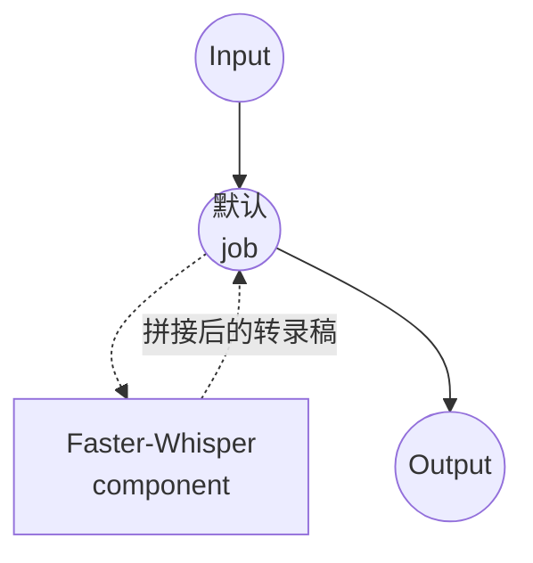

# Speech-to-Text Faster-Whisper 模型任务示例

本示例演示如何使用 Faster-Whisper 将长音频文件转录为单个纯文本转录稿。Faster-Whisper 是 OpenAI Whisper 的 CTranslate2 重新实现版本，相较于原生 HuggingFace 移植版明显更快、内存占用更低。

## 概述

此工作流提供本地语音转文字转录功能：

1. **长音频**：接受任意长度的音频；Faster-Whisper 在内部以 30 秒解码窗口滑动穿越波形，并将各段拼接回单个转录稿
2. **单一文本输出**：以纯字符串形式返回完整转录稿，可直接保存为 `.txt` 文件
3. **VAD 预过滤**：Silero VAD 在解码前跳过静音区域，减少在存在较长停顿的长录音中出现的幻觉文本
4. **上下文承接**：前一段的文本作为提示传入下一个窗口，使标点和风格在块边界处保持一致
5. **转录或翻译**：可在调用时在保留源语言与翻译为英语之间切换
6. **本地模型执行**：通过 `faster-whisper` / CTranslate2 完全离线运行

长音频拼接在 Faster-Whisper 内部完成，因此**无需**使用 `audio-clipper` 或 shell 预处理自行分割文件 — 传入完整音频即可得到完整转录稿。

## 准备工作

### 先决条件

- 已安装 model-compose 并在 PATH 中可用
- 运行 Faster-Whisper 所需的充足系统资源（推荐：8GB+ RAM，`large-v3` 推荐 GPU）
- 带有 `faster-whisper`、`torch`、`torchaudio`、`numpy` 和 `soxr` 的 Python 环境（自动管理）

### 为什么选择 Faster-Whisper

与原生 Whisper 相比，Faster-Whisper 是一个专注于吞吐量的直接替代实现：

**优势：**
- **速度**：在同等质量下通常比 HuggingFace Whisper 移植版快 2–4 倍
- **更低内存**：`int8` 和 `int8_float16` 计算类型在质量损失较小的前提下显著减少 VRAM/RAM 占用
- **内置长音频处理**：`chunk_length` 处理多分钟甚至多小时音频，无需手动分割
- **内置 VAD**：Silero VAD 可跳过静音，进一步减少计算量和幻觉
- **隐私**：所有音频处理在本地进行，不会将数据发送至外部

**权衡：**
- **设置**：首次运行下载 Faster-Whisper 权重（CTranslate2 格式），而非原始 Whisper 检查点
- **词级时间戳**：支持但为可选开启；本示例保持关闭以返回干净的文本字符串

### 环境配置

1. 导航到此示例目录：
   ```bash
   cd examples/model-tasks/speech-to-text-faster-whisper
   ```

2. 无需额外的环境配置 - 模型和依赖项自动管理。

## 如何运行

1. **启动服务：**
   ```bash
   model-compose up
   ```

2. **运行工作流：**

   **使用 API：**
   ```bash
   # 自动检测语言，以源语言转录
   curl -X POST http://localhost:8080/api/workflows/runs \
     -F "audio=@/path/to/long-audio.mp3" \
     -F 'input={"audio": "@audio"}'

   # 显式指定韩语，翻译为英语
   curl -X POST http://localhost:8080/api/workflows/runs \
     -F "audio=@/path/to/long-audio.mp3" \
     -F 'input={"audio": "@audio", "language": "ko", "task": "translate"}'
   ```

   **使用 Web UI：**
   - 打开 Web UI：http://localhost:8081
   - 上传音频文件（MP3、WAV、FLAC、M4A 等）
   - 可选设置 `language`（例如 `en`、`ko`、`ja`）；留空则自动检测
   - 选择 `task`：`transcribe`（保留源语言）或 `translate`（输出英语）
   - 点击 "Run Workflow" 按钮

   **使用 CLI：**
   ```bash
   # 简单转录，直接将转录稿写入文件
   model-compose run --input '{"audio": "/path/to/long-audio.mp3"}' \
     | jq -r '.transcription' > transcript.txt
   ```

## 组件详情

### Speech to Text Model 组件（默认）
- **类型**：带 speech-to-text 任务的模型组件
- **用途**：使用 Faster-Whisper 进行本地长音频转录
- **模型**：`Systran/faster-whisper-large-v3`
- **Family**：faster-whisper
- **功能**：
  - 自动模型下载和缓存
  - 面向长音频的内部 30 秒分块
  - 可选的 Silero VAD 预过滤
  - 通过 `condition_on_previous_text` 在块之间承接上下文
  - CPU 和 GPU 加速

### 模型信息：Faster-Whisper
- **开发者**：SYSTRAN（将 OpenAI Whisper 移植到 CTranslate2）
- **基础架构**：Whisper
- **可用变体**：`Systran/faster-whisper-tiny`、`-base`、`-small`、`-medium`、`-large-v2`、`-large-v3`、`-distil-large-v3`
- **能力**：多语言转录、英语翻译、段级和词级时间戳

## 工作流详情

### "Speech to Text (Faster-Whisper)" 工作流（默认）

**描述**：使用本地 Faster-Whisper 模型将长音频文件转录为单个转录稿。

#### 作业流程

此示例使用简化的单组件配置，没有显式作业。



#### 输入参数

| 参数 | 类型 | 必需 | 默认值 | 描述 |
|-----|------|------|--------|------|
| `audio` | audio | 是 | - | 输入音频文件（MP3、WAV、FLAC、M4A 等）；任意长度 |
| `language` | text | 否 | *(自动)* | BCP-47 语言代码（例如 `en`、`ko`、`ja`）；省略则自动检测 |
| `task` | text | 否 | `transcribe` | `transcribe` 保留源语言；`translate` 输出英语 |

#### 输出格式

| 字段 | 类型 | 描述 |
|-----|------|------|
| `transcription` | text | 完整转录稿，以单一纯文本字符串形式返回 |

## 系统要求

### 最低要求
- **RAM**：8GB（`large-v3` 推荐 16GB+）
- **VRAM**：`large-v3` 推荐 6GB+ GPU
- **磁盘空间**：模型及其缓存需 3GB+
- **CPU**：多核处理器（仅 CPU 运行推荐 4+ 核）
- **互联网**：仅初始模型下载需要

### 性能说明
- 首次运行需要下载 CTranslate2 权重（`large-v3` 约 3GB）
- 模型加载需要 10–30 秒，具体取决于硬件
- GPU 加速可显著提升推理速度
- `int8` 和 `int8_float16` 计算类型以较小的质量损失换取显著的内存节省

## 自定义

### 选择更小或更快的模型

通过选择较小变体以质量换速度：

```yaml
component:
  type: model
  task: speech-to-text
  driver: custom
  family: faster-whisper
  model: Systran/faster-whisper-distil-large-v3   # 或 ...-medium、...-small、...-base、...-tiny
```

### 在 GPU 上运行

默认配置使用 `device: auto`。当有可用 GPU 时固定为 CUDA：

```yaml
component:
  type: model
  task: speech-to-text
  driver: custom
  family: faster-whisper
  model: Systran/faster-whisper-large-v3
  device: cuda:0
  compute_type: float16
```

### 返回时间戳而非纯文本

打开 `return_timestamps` 以获取包含 `start_time`、`end_time` 和 `text` 的段 JSON 列表：

```yaml
workflow:
  job:
    input: ${input}
    output:
      transcription: ${output as json}

component:
  action:
    audio: ${input.audio as audio}
    chunk_length: 30
    return_timestamps: true
    timestamp_level: segment     # 词级时间使用 'word'
```

### 调优长音频流水线

对长或嘈杂录音最有用的参数：

```yaml
component:
  action:
    audio: ${input.audio as audio}
    chunk_length: 30                       # 解码窗口长度（秒）
    params:
      vad_filter: true                     # Silero VAD 跳过静音区域
      condition_on_previous_text: true     # 在块边界保持上下文
      vad_parameters:
        min_silence_duration_ms: 2000      # 合并间隔小于 2 秒的区域
        speech_pad_ms: 400                 # 每个语音区域周围的填充
```

## 故障排除

### 常见问题

1. **内存不足**：使用更小的变体（`distil-large-v3`、`medium`、`small`）或设置 `compute_type: int8` / `int8_float16`
2. **模型下载失败**：检查互联网连接和可用磁盘空间
3. **CPU 上处理缓慢**：启用 `vad_filter: true` 以跳过静音，并优先选择 `distil-large-v3` 或 `medium` 而非 `large-v3`
4. **静音处的幻觉文本**：启用 `vad_filter: true`；将 `params.no_speech_threshold` 提升到 `0.8` 附近
5. **长静音后的重复循环**：设置 `condition_on_previous_text: false`

### 性能优化

- **设备**：`cuda:0` 搭配 `compute_type: float16` 可获得最大加速
- **计算类型**：GPU 上使用 `int8_float16` 或 CPU 上使用 `int8`，以较小的质量损失换取显著的内存节省
- **语言指定**：显式设置 `language` 可跳过自动检测，同时提升速度和精度
- **VAD**：`vad_filter: true` 可在存在长静音段的录音中大幅缩短解码时间

## 相关示例

- [speech-to-text](../speech-to-text) — 通过 HuggingFace transformers 的原生 Whisper
- [speech-to-text-crisper-whisper](../speech-to-text-crisper-whisper) — 带词级时间戳的逐字转录
- [speech-to-text-vibevoice](../speech-to-text-vibevoice) — 带说话人归属的长音频转录
- [speech-to-text-vibevoice-streaming](../speech-to-text-vibevoice-streaming) — 逐块流式转录
