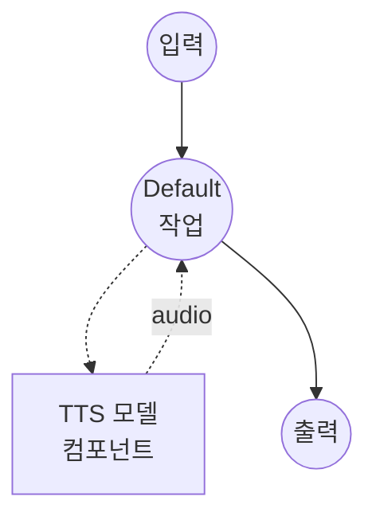

# 텍스트 음성 변환 (Supertonic 3) 모델 태스크 예제

이 예제는 ONNX Runtime을 통해 CPU에서 완전히 실행되는 경량 온디바이스 TTS 시스템인 Supertonic 3를 사용하여 텍스트로부터 음성을 합성하는 방법을 보여줍니다.

## 개요

이 워크플로우는 다음과 같은 로컬 음성 합성을 제공합니다:

1. **로컬 모델 실행**: ONNX Runtime을 통해 Supertonic 3를 로컬에서 실행 — 클라우드 불필요, API 키 불필요
2. **CPU 우선 추론**: 총 ~99M 파라미터; 일반 CPU에서도 실시간 처리 가능
3. **31개 언어 + 폴백**: 31개 언어 네이티브 지원 + 그 외 언어를 위한 언어 무관 `na` 폴백
4. **10개 내장 보이스**: 프리셋 스타일 `M1`-`M5` (남성) 및 `F1`-`F5` (여성)
5. **44.1 kHz 출력**: 모델 네이티브 샘플 레이트의 프로덕션 품질 16-bit WAV

## 준비사항

### 필수 요구사항

- model-compose가 설치되어 PATH에서 사용 가능
- 첫 실행 시 인터넷 연결 필요 (모델 가중치를 HuggingFace에서 다운로드)

### 모델 가중치

컴포넌트가 처음 시작될 때, `model-compose.yml`에 고정된 리비전으로 선언된 Supertonic 3 아카이브 가중치가 HuggingFace에서 자동으로 다운로드됩니다:

- 저장소: `supertone-oss-archive/supertonic-3`
- 리비전: `aafc6e32416a594460b32413efc49d7fe4ce6d46`

이후 실행에서는 캐시된 스냅샷을 사용합니다.

### 환경 구성

1. 이 예제 디렉토리로 이동:
   ```bash
   cd examples/model-tasks/text-to-speech-generate-supertonic
   ```

2. 추가 환경 구성이 필요 없습니다.

## 실행 방법

1. **서비스 시작:**
   ```bash
   model-compose up
   ```

2. **워크플로우 실행:**

   **웹 UI 사용 (권장):**
   - 웹 UI 열기: http://localhost:8081
   - 합성할 텍스트 입력
   - 보이스 선택 (`M1`-`M5` 또는 `F1`-`F5`)
   - 언어 코드 선택
   - 선택적으로 속도 조절
   - "Run Workflow" 버튼 클릭

   **API 사용:**
   ```bash
   curl -X POST http://localhost:8080/api/workflows/runs \
     -H "Content-Type: application/json" \
     -d '{
       "input": {
         "text": "Supertonic 3가 전해드립니다.",
         "voice": "F1",
         "language": "ko",
         "speed": 1.05
       }
     }'
   ```

   **CLI 사용:**
   ```bash
   model-compose run --input '{
     "text": "Supertonic 3가 전해드립니다.",
     "voice": "F1",
     "language": "ko",
     "speed": 1.05
   }'
   ```

## 컴포넌트 세부사항

### 텍스트 음성 변환 모델 컴포넌트 (기본)
- **유형**: `text-to-speech` 태스크를 가진 모델 컴포넌트
- **목적**: 프리셋 보이스를 사용한 음성 합성
- **모델**: `supertone-oss-archive/supertonic-3` (고정 리비전)
- **드라이버**: `custom`
- **패밀리**: `supertonic`
- **디바이스**: `cpu` (Supertonic은 ONNX Runtime에서 실행)
- **메서드**: `generate` — 내장 보이스 스타일로 음성 합성
- **동시성**: 1 (한 번에 하나의 요청)

### 모델 정보: Supertonic 3
- **개발자**: Supertone
- **유형**: 보이스 스타일 컨디셔닝을 지원하는 ONNX 기반 디퓨전 TTS
- **파라미터**: ~99M (공개된 ONNX 자산 전체 합산)
- **샘플 레이트**: 44.1 kHz 출력
- **언어**: 31개 네이티브 지원 (아랍어, 불가리아어, 크로아티아어, 체코어, 덴마크어, 네덜란드어, 영어, 에스토니아어, 핀란드어, 프랑스어, 독일어, 그리스어, 힌디어, 헝가리어, 인도네시아어, 이탈리아어, 일본어, 한국어, 라트비아어, 리투아니아어, 폴란드어, 포르투갈어, 루마니아어, 러시아어, 슬로바키아어, 슬로베니아어, 스페인어, 스웨덴어, 터키어, 우크라이나어, 베트남어) 및 그 외 언어용 `na`
- **출력 형식**: 오디오 (WAV, 16-bit)

## 워크플로우 세부사항

### "Text to Speech (Supertonic 3)" 워크플로우 (기본)

**설명**: ONNX Runtime을 통해 CPU에서 실행되는 Supertonic 3로 44.1 kHz의 다국어 온디바이스 음성 합성.

#### 작업 흐름



#### 입력 매개변수

| 매개변수 | 유형 | 필수 | 기본값 | 설명 |
|-----------|------|----------|---------|-------------|
| `text` | text | 예 | - | 음성으로 변환할 텍스트 |
| `voice` | text | 아니오 | `F1` | 내장 보이스 스타일(`M1`-`M5`, `F1`-`F5`) 또는 Voice Builder JSON 파일 경로 |
| `language` | text | 아니오 | `en` | Supertonic 3가 지원하는 ISO 639-1 코드; 미지원 코드는 `na`로 폴백 |
| `speed` | number | 아니오 | `1.05` | 음성 속도 배수 (범위 0.7 - 2.0) |

#### 출력 형식

| 필드 | 유형 | 설명 |
|-----|------|------|
| - | audio | 생성된 음성 오디오 (WAV, 44.1 kHz, 16-bit) |

## 예시 출력

워크플로우는 44.1 kHz, 16-bit, 모노로 합성된 음성이 담긴 WAV 오디오 스트림을 반환합니다.

## 맞춤화

### 커스텀 보이스 스타일 사용

Supertonic의 Voice Builder (아카이브됨)는 보이스 스타일을 JSON 파일로 내보냅니다. `voice`에 로컬 경로를 지정하면 해당 파일을 사용합니다:

```yaml
action:
  method: generate
  text: ${input.text as text}
  voice: /path/to/my_voice.json
  language: en
```

경로 구분자가 포함되었거나 `.json`으로 끝나는 값은 커스텀 보이스 파일로 처리되고, 그 외의 값은 내장 보이스 ID로 해석됩니다.

### 청킹 및 포즈 조정

긴 입력은 Supertonic이 자동으로 청크 단위로 분할합니다. 액션 설정에서 기본값을 재정의할 수 있습니다:

```yaml
action:
  method: generate
  text: ${input.text as text}
  voice: F1
  language: en
  total_steps: 8          # 5-12; 높을수록 품질↑, 속도↓
  max_chunk_length: 300   # 청크당 문자 수 (한국어 기본값은 120)
  silence_duration: 0.3   # 청크 사이에 삽입되는 무음(초)
```

## 관련 예제

- **[text-to-speech-generate](../text-to-speech-generate/)**: Qwen3-TTS를 사용한 프리셋 보이스 합성
- **[text-to-speech-clone-fireredtts3](../text-to-speech-clone-fireredtts3/)**: FireRedTTS3를 사용한 제로샷 보이스 클로닝
- **[text-to-speech-clone-cosyvoice](../text-to-speech-clone-cosyvoice/)**: CosyVoice2를 사용한 보이스 클로닝
