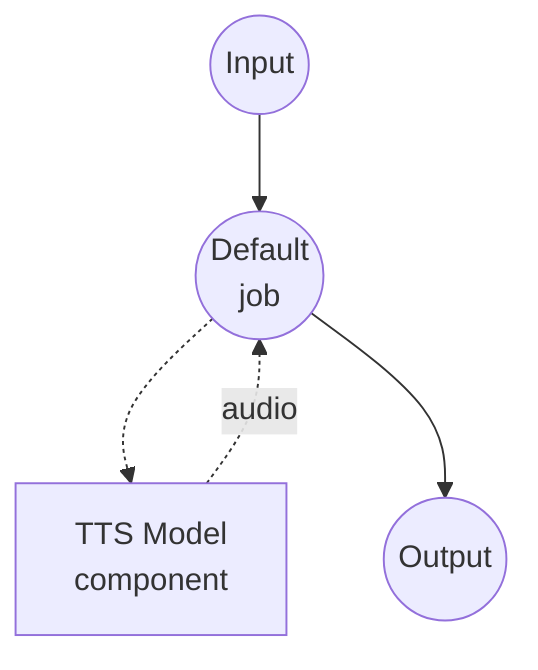

# Text to Speech (Supertonic 3) Model Task Example

This example demonstrates how to synthesize speech from text using Supertonic 3, a lightweight on-device TTS system that runs entirely on CPU via ONNX Runtime.

## Overview

This workflow provides local speech synthesis that:

1. **Local Model Execution**: Runs Supertonic 3 locally through ONNX Runtime - no cloud, no API keys
2. **CPU-First Inference**: ~99M parameters total; comfortably real-time on commodity CPUs
3. **31 Languages + Fallback**: Native support for 31 languages plus a language-agnostic `na` fallback for anything else
4. **10 Built-in Voices**: Preset styles `M1`-`M5` (male) and `F1`-`F5` (female)
5. **44.1 kHz Output**: Production-ready 16-bit WAV at the model's native sample rate

## Preparation

### Prerequisites

- model-compose installed and available in your PATH
- Internet access for the first run (model weights are fetched from HuggingFace)

### Model Weights

The first time the component starts, the archived Supertonic 3 weights are downloaded automatically from HuggingFace at the pinned revision declared in `model-compose.yml`:

- Repository: `supertone-oss-archive/supertonic-3`
- Revision: `aafc6e32416a594460b32413efc49d7fe4ce6d46`

Subsequent runs use the cached snapshot.

### Environment Configuration

1. Navigate to this example directory:
   ```bash
   cd examples/model-tasks/text-to-speech-generate-supertonic
   ```

2. No additional environment configuration required.

## How to Run

1. **Start the service:**
   ```bash
   model-compose up
   ```

2. **Run the workflow:**

   **Using Web UI (Recommended):**
   - Open the Web UI: http://localhost:8081
   - Enter the text to synthesize
   - Pick a voice (`M1`-`M5` or `F1`-`F5`)
   - Pick a language code
   - Optionally tune the speed
   - Click the "Run Workflow" button

   **Using API:**
   ```bash
   curl -X POST http://localhost:8080/api/workflows/runs \
     -H "Content-Type: application/json" \
     -d '{
       "input": {
         "text": "Hello from Supertonic three.",
         "voice": "F1",
         "language": "en",
         "speed": 1.05
       }
     }'
   ```

   **Using CLI:**
   ```bash
   model-compose run --input '{
     "text": "Hello from Supertonic three.",
     "voice": "F1",
     "language": "en",
     "speed": 1.05
   }'
   ```

## Component Details

### Text-to-Speech Model Component (Default)
- **Type**: Model component with `text-to-speech` task
- **Purpose**: Preset-voice speech synthesis from text
- **Model**: `supertone-oss-archive/supertonic-3` (pinned revision)
- **Driver**: `custom`
- **Family**: `supertonic`
- **Device**: `cpu` (Supertonic runs on ONNX Runtime)
- **Method**: `generate` - synthesizes speech using a built-in voice style
- **Concurrency**: 1 (single request at a time)

### Model Information: Supertonic 3
- **Developer**: Supertone
- **Type**: ONNX-based diffusion TTS with voice-style conditioning
- **Parameters**: ~99M (across the public ONNX assets)
- **Sample Rate**: 44.1 kHz output
- **Languages**: 31 native (Arabic, Bulgarian, Croatian, Czech, Danish, Dutch, English, Estonian, Finnish, French, German, Greek, Hindi, Hungarian, Indonesian, Italian, Japanese, Korean, Latvian, Lithuanian, Polish, Portuguese, Romanian, Russian, Slovak, Slovenian, Spanish, Swedish, Turkish, Ukrainian, Vietnamese) plus `na` for anything else
- **Output Format**: Audio (WAV, 16-bit)

## Workflow Details

### "Text to Speech (Supertonic 3)" Workflow (Default)

**Description**: Multilingual on-device speech synthesis via Supertonic 3, running on CPU through ONNX Runtime at 44.1 kHz.

#### Job Flow



#### Input Parameters

| Parameter | Type | Required | Default | Description |
|-----------|------|----------|---------|-------------|
| `text` | text | Yes | - | Text to synthesize into speech |
| `voice` | text | No | `F1` | Built-in voice style (`M1`-`M5`, `F1`-`F5`) or path to a Voice Builder JSON file |
| `language` | text | No | `en` | ISO 639-1 code supported by Supertonic 3; unknown codes fall back to `na` |
| `speed` | number | No | `1.05` | Speech speed multiplier (range 0.7 - 2.0) |

#### Output Format

| Field | Type | Description |
|-------|------|-------------|
| - | audio | Generated speech audio (WAV, 44.1 kHz, 16-bit) |

## Example Output

The workflow returns a WAV audio stream containing synthesized speech at 44.1 kHz, 16-bit, mono.

## Customization

### Using a Custom Voice Style

Supertonic's Voice Builder (archived) exports voice styles as JSON files. Point `voice` at a local path to use one:

```yaml
action:
  method: generate
  text: ${input.text as text}
  voice: /path/to/my_voice.json
  language: en
```

Any value containing a path separator or ending in `.json` is treated as a custom voice file; everything else resolves to a built-in voice ID.

### Tuning Chunking and Pauses

Long inputs are chunked by Supertonic automatically. Override the defaults in the action config:

```yaml
action:
  method: generate
  text: ${input.text as text}
  voice: F1
  language: en
  total_steps: 8          # 5-12; higher = better quality, slower
  max_chunk_length: 300   # characters per chunk (120 for Korean by default)
  silence_duration: 0.3   # seconds of silence inserted between chunks
```

## Related Examples

- **[text-to-speech-generate](../text-to-speech-generate/)**: Preset-voice synthesis with Qwen3-TTS
- **[text-to-speech-clone-fireredtts3](../text-to-speech-clone-fireredtts3/)**: Zero-shot voice cloning with FireRedTTS3
- **[text-to-speech-clone-cosyvoice](../text-to-speech-clone-cosyvoice/)**: Voice cloning with CosyVoice2
