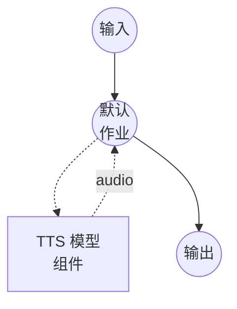

# 文本转语音（Supertonic 3）模型任务示例

此示例演示如何使用 Supertonic 3 从文本合成语音，Supertonic 3 是一个轻量级的本地 TTS 系统，通过 ONNX Runtime 完全运行在 CPU 上。

## 概述

此工作流提供本地语音合成：

1. **本地模型执行**：通过 ONNX Runtime 在本地运行 Supertonic 3 — 无需云端、无需 API 密钥
2. **CPU 优先推理**：参数总量约 99M；在普通 CPU 上即可实时运行
3. **31 种语言 + 回退**：原生支持 31 种语言，其他语言回退至与语言无关的 `na`
4. **10 种内置语音**：预设风格 `M1`-`M5`（男声）和 `F1`-`F5`（女声）
5. **44.1 kHz 输出**：模型原生采样率下的生产级 16-bit WAV

## 准备工作

### 前置条件

- 已安装 model-compose 并在您的 PATH 中可用
- 首次运行需要联网（模型权重从 HuggingFace 下载）

### 模型权重

组件首次启动时，会按照 `model-compose.yml` 中声明的固定修订版自动从 HuggingFace 下载 Supertonic 3 归档权重：

- 仓库：`supertone-oss-archive/supertonic-3`
- 修订版：`aafc6e32416a594460b32413efc49d7fe4ce6d46`

后续运行使用缓存的快照。

### 环境配置

1. 导航到此示例目录：
   ```bash
   cd examples/model-tasks/text-to-speech-generate-supertonic
   ```

2. 无需额外的环境配置。

## 运行方式

1. **启动服务：**
   ```bash
   model-compose up
   ```

2. **运行工作流：**

   **使用 Web UI（推荐）：**
   - 打开 Web UI：http://localhost:8081
   - 输入要合成的文本
   - 选择语音（`M1`-`M5` 或 `F1`-`F5`）
   - 选择语言代码
   - 可选地调整语速
   - 点击"Run Workflow"按钮

   **使用 API：**
   ```bash
   curl -X POST http://localhost:8080/api/workflows/runs \
     -H "Content-Type: application/json" \
     -d '{
       "input": {
         "text": "来自 Supertonic 三的问候。",
         "voice": "F1",
         "language": "na",
         "speed": 1.05
       }
     }'
   ```

   **使用 CLI：**
   ```bash
   model-compose run --input '{
     "text": "来自 Supertonic 三的问候。",
     "voice": "F1",
     "language": "na",
     "speed": 1.05
   }'
   ```

## 组件详情

### 文本转语音模型组件（默认）
- **类型**：具有 `text-to-speech` 任务的模型组件
- **用途**：使用预设语音从文本合成语音
- **模型**：`supertone-oss-archive/supertonic-3`（固定修订版）
- **驱动**：`custom`
- **系列**：`supertonic`
- **设备**：`cpu`（Supertonic 运行于 ONNX Runtime）
- **方法**：`generate` —— 使用内置语音风格合成语音
- **并发数**：1（同时处理一个请求）

### 模型信息：Supertonic 3
- **开发者**：Supertone
- **类型**：基于 ONNX 的扩散式 TTS，支持语音风格条件化
- **参数**：约 99M（公开 ONNX 资产合计）
- **采样率**：44.1 kHz 输出
- **语言**：原生支持 31 种（阿拉伯语、保加利亚语、克罗地亚语、捷克语、丹麦语、荷兰语、英语、爱沙尼亚语、芬兰语、法语、德语、希腊语、印地语、匈牙利语、印尼语、意大利语、日语、韩语、拉脱维亚语、立陶宛语、波兰语、葡萄牙语、罗马尼亚语、俄语、斯洛伐克语、斯洛文尼亚语、西班牙语、瑞典语、土耳其语、乌克兰语、越南语），其他语言使用 `na`
- **输出格式**：音频（WAV，16-bit）

## 工作流详情

### "Text to Speech (Supertonic 3)" 工作流（默认）

**描述**：通过 Supertonic 3 实现多语言本地语音合成，经由 ONNX Runtime 在 CPU 上以 44.1 kHz 运行。

#### 作业流程



#### 输入参数

| 参数 | 类型 | 必需 | 默认值 | 描述 |
|-----------|------|----------|---------|-------------|
| `text` | text | 是 | - | 要合成为语音的文本 |
| `voice` | text | 否 | `F1` | 内置语音风格（`M1`-`M5`、`F1`-`F5`）或 Voice Builder JSON 文件路径 |
| `language` | text | 否 | `en` | Supertonic 3 支持的 ISO 639-1 代码；未知代码回退为 `na` |
| `speed` | number | 否 | `1.05` | 语速倍数（范围 0.7 - 2.0） |

#### 输出格式

| 字段 | 类型 | 描述 |
|-------|------|-------------|
| - | audio | 生成的语音音频（WAV，44.1 kHz，16-bit） |

## 示例输出

工作流返回一段 WAV 音频流，内容为 44.1 kHz、16-bit、单声道的合成语音。

## 自定义

### 使用自定义语音风格

Supertonic 的 Voice Builder（已归档）会将语音风格导出为 JSON 文件。将 `voice` 指向本地路径即可使用：

```yaml
action:
  method: generate
  text: ${input.text as text}
  voice: /path/to/my_voice.json
  language: en
```

任何包含路径分隔符或以 `.json` 结尾的值会被视为自定义语音文件；其他值解析为内置语音 ID。

### 调整分块与停顿

Supertonic 会自动对长输入进行分块。可在动作配置中覆盖默认值：

```yaml
action:
  method: generate
  text: ${input.text as text}
  voice: F1
  language: en
  total_steps: 8          # 5-12；数值越大质量越高、速度越慢
  max_chunk_length: 300   # 每块的字符数（韩语默认为 120）
  silence_duration: 0.3   # 块之间插入的静音时长（秒）
```

## 相关示例

- **[text-to-speech-generate](../text-to-speech-generate/)**: 使用 Qwen3-TTS 的预设语音合成
- **[text-to-speech-clone-fireredtts3](../text-to-speech-clone-fireredtts3/)**: 使用 FireRedTTS3 的零样本语音克隆
- **[text-to-speech-clone-cosyvoice](../text-to-speech-clone-cosyvoice/)**: 使用 CosyVoice2 的语音克隆
